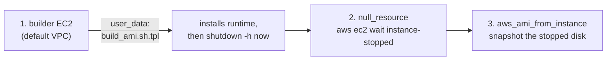

# 12 — A Golden AMI from an Existing Instance

> Auto Scaling launches instances with nobody watching. Each one must come
> up ready to serve within a minute or two — so the slow, rarely-changing
> part (OS packages, Node, PM2, Nginx, AWS CLI) gets baked into an image
> once, here, and every instance in lesson 13 boots from it.

## 1. Why an AMI at all

Every lesson up to 11 booted stock Ubuntu and installed everything in
`user_data`: apt update, Postgres client, AWS CLI v2, Node, PM2 — around
two minutes before the app even starts. Fine for one hand-launched
instance. Not fine for Auto Scaling:

| Event | What happens without a baked image |
|---|---|
| Traffic spike → scale-out | New capacity arrives ~2 minutes *after* the spike, while users wait |
| Instance dies → self-healing | Replacement takes the full install time; the tier runs short meanwhile |
| npm/apt/nodesource outage | **No instance can boot at all** — the ASG keeps launching and killing failures |

That last row matters most. An image that already contains the runtime
removes a whole category of boot-time dependency on the internet.

## 2. What goes in the image — and what deliberately doesn't

| Baked into the AMI (changes rarely) | Fetched at boot (changes every release) |
|---|---|
| Ubuntu 24.04 + security updates at build time | The app build (`frontend.zip`, `backend.zip`) |
| Node.js 20, PM2 | `.env` / the DB password (from Secrets Manager) |
| Nginx (installed, **disabled**) | Which role this instance plays (frontend vs backend) |
| AWS CLI v2, `postgresql-client`, `python3` | |
| `stress-ng` (lesson 13's scaling demo) | |
| **CodeDeploy agent** (unused until the CodePipeline topic) | |

There are two schools here:

- **Fully baked** — app code inside the AMI too. Fastest possible boot,
  perfectly immutable, but *every release needs a new AMI* (~10+ minutes
  of snapshotting, see below) and a launch-template change.
- **Runtime-only** (this repo) — the image is the platform; the release
  arrives at boot. In lesson 13 that's `aws s3 cp` in `user_data`. In the CI/CD
  with CodePipeline topic, CodePipeline + CodeDeploy take over that one step — and because
  the CodeDeploy agent is already in this image, any instance an ASG
  launches can receive a deployment immediately. The AMI doesn't change
  when the app does.

One image serves **both** tiers. Nginx is installed but switched off;
only the frontend's launch template turns it on. One image to build,
patch and track instead of two.

## 3. How Terraform builds it

There's no single "make an AMI from this script" resource in Terraform
(that's what Packer is for — a separate tool). Instead, three ordinary
pieces in [`main.tf`](main.tf):



1. **Builder instance** — the `ec2` module from earlier lessons, booting
   [`build_ami.sh.tpl`](build_ami.sh.tpl). It runs in the default VPC's
   public subnet so it can download packages without a NAT Gateway.
2. **Wait** — Terraform marks an instance "created" as soon as it's
   `running`, which says nothing about whether `user_data` finished.
   Snapshotting then would capture a half-installed disk. So the build
   script's **last line powers the instance off**, and a `null_resource`
   runs `aws ec2 wait instance-stopped` until it does. Because the script
   has `set -e`, a failed step leaves the instance *running* — the wait
   times out and the apply fails, instead of silently producing a broken
   image.
3. **`aws_ami_from_instance`** — snapshot the stopped instance. Stopped
   means nothing is writing to the disk, so `snapshot_without_reboot =
   true` is safe.

The AMI is tagged `Name = three-tier-terraform-app-runtime`; lesson 13
finds it with a `data "aws_ami"` filter on that tag — never by a pasted ID.

## 4. Run it

```bash
cd 12-golden-ami
cp backend.hcl.example backend.hcl   # bootstrap from lesson 04 must exist
terraform init -backend-config=backend.hcl
terraform apply                      # ~12 minutes, mostly the snapshot
```

Real output:

```console
$ terraform apply -auto-approve
module.builder.aws_instance.this: Creation complete after 13s [id=i-0f9ca0ea595c197d8]
null_resource.wait_for_build: Still creating... [02m20s elapsed]
null_resource.wait_for_build: Creation complete after 2m34s
aws_ami_from_instance.runtime: Still creating... [09m30s elapsed]
aws_ami_from_instance.runtime: Creation complete after 9m42s [id=ami-0925eca8f118ba4f7]

Apply complete! Resources: 3 added, 0 changed, 0 destroyed.

Outputs:
ami_id = "ami-0925eca8f118ba4f7"
ami_name = "three-tier-terraform-app-runtime-v1"
builder_instance_id = "i-0f9ca0ea595c197d8"
```

The install itself took **2m34s**. The snapshot took **9m42s** — a first
EBS snapshot copies every used block of the 20 GB volume. That number is
the real cost of the "fully baked" school from §2: paid on every release,
not once.

Verified with the AWS CLI:

```console
$ aws ec2 describe-images --image-ids ami-0925eca8f118ba4f7 \
    --query 'Images[0].[State,Name,BlockDeviceMappings[0].Ebs.[VolumeSize,Encrypted]]'
available   three-tier-terraform-app-runtime-v1
20          True

$ aws ec2 describe-instances --instance-ids i-0f9ca0ea595c197d8 --query '...State.Name'
stopped
```

The root volume stays encrypted (inherited from the `ec2` module's
`encrypted = true`), and the builder is stopped — it costs only its EBS
volume (~US$0.05/day) while it sits there.

What's inside is recorded on the image itself, in
`/etc/three-tier-ami-release` (Node/PM2/AWS CLI/Nginx/CodeDeploy versions
and build time) — lesson 13 reads it back from a running instance.

## 5. Making a new version — and two real bugs v1 shipped with

### Bug 1: v1's release file

Lesson 13 read `/etc/three-tier-ami-release` off a running instance, and
the `pm2=` line was a full-screen ASCII-art banner:

```console
version=v1
node=v20.20.2
pm2=
                        -------------
__/\\\\\\\\\\\\\____/\\\\____________/\\\\____/\\\\\\\\\_____
...
[PM2] Spawning PM2 daemon with pm2_home=/root/.pm2
[PM2] PM2 Successfully daemonized
7.0.4
aws=aws-cli/2.37.12
```

The *first* `pm2` command of any kind — even `pm2 --version` — starts
PM2's background daemon and prints its welcome banner. So v1 captured the
banner into the file *and* baked a started-then-killed PM2 runtime
directory into the image. Harmless here, but exactly the kind of
build-time side effect a golden image shouldn't carry. Fix: read the
version without running PM2 at all:

```bash
pm2=$(node -p "require('/usr/lib/node_modules/pm2/package.json').version")
```

### Bug 2: the replacement would have deleted v1 first

Before baking v2, a plan showed:

```console
-/+ resource "aws_ami_from_instance" "runtime" {
      ~ name = "three-tier-terraform-app-runtime-v1" -> "three-tier-terraform-app-runtime-v2" # forces replacement
```

`-/+` is **destroy, then create**. Terraform would deregister v1 first,
then spend ~12 minutes building v2 — while lesson 13's two launch
templates still point at v1. Any self-healing replacement or scale-out in
that window tries to launch from an image that no longer exists, and
fails. Fix in [`main.tf`](main.tf):

```hcl
resource "aws_ami_from_instance" "runtime" {
  ...
  lifecycle {
    create_before_destroy = true
  }
}
```

Safe here because the name embeds `ami_version`, so v1 and v2 can exist at
the same time. Re-planned:

```console
+/- create replacement and then destroy
+/- resource "aws_ami_from_instance" "runtime" {
```

### Baking v2

```console
$ terraform apply -var ami_version=v2 -auto-approve
module.builder.aws_instance.this: Creation complete after 14s [id=i-053881c0294332f92]
null_resource.wait_for_build: Creation complete after 2m48s
aws_ami_from_instance.runtime: Creation complete after 10m42s [id=ami-080a465540b83b657]
aws_ami_from_instance.runtime: Destruction complete after 6s        ← v1, only now
module.builder.aws_instance.this: Destruction complete after 11s    ← old builder

Apply complete! Resources: 3 added, 0 changed, 3 destroyed.
ami_name = "three-tier-terraform-app-runtime-v2"
```

v1 was deregistered only after v2 existed. Lesson 13's `most_recent =
true` lookup then picked v2 up on its next apply and rolled every instance
onto it with an instance refresh — see
[lesson 13 §7](../13-auto-scaling-groups/README.md#7-managing-the-fleet-as-code--instance-refresh).

## 6. Clean up — order matters

**Keep this lesson applied while lesson 13 is running.** Lesson 13 looks
the image up by tag at plan time; destroy it first and lesson 13 can't
even plan. When you're done with both:

```bash
cd ../13-auto-scaling-groups && terraform destroy
cd ../12-golden-ami && terraform destroy   # deregisters the AMI, deletes its snapshot and the builder
```

## If it breaks

- `null_resource.wait_for_build` fails with `Max attempts exceeded` — the
  build script failed partway, so the instance never shut down. Read the
  log on the still-running builder:
  `aws ec2 get-console-output --instance-id <builder-id> --latest --output text | tail -50`
  (the full log is `/var/log/ami-build.log` on the instance).
- CodeDeploy agent install fails — the installer URL is region-specific
  (`aws-codedeploy-<region>`); `build_ami.sh.tpl` takes it from
  `var.aws_region`, so a typo'd region shows up here first.
- `InvalidAMIName.Duplicate` — an AMI named `...-v1` already exists (a
  previous run you didn't destroy). Bump `ami_version` or deregister it.

## Next

**[13 — Auto Scaling Groups](../13-auto-scaling-groups/)**
