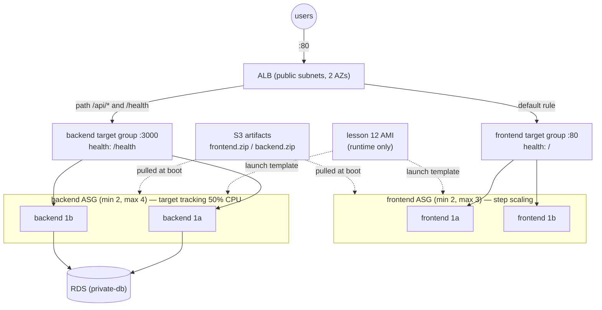

# 13 — Auto Scaling Groups (High Availability & Self-Healing)

> Lesson 11's single backend and single frontend instance become fleets:
> launch templates built from lesson 12's AMI, one Auto Scaling Group per
> tier spread across two AZs, the ALB routing by path, ELB health checks
> that replace instances whose *app* died, target tracking and step
> scaling, and instance refresh to roll every instance from code. Every
> claim below was triggered on purpose against real AWS and timed.

## 1. Why Auto Scaling is mandatory in production

Lesson 11's architecture is private, load-balanced and tidy — and still
fragile:

| Failure | Lesson 11 (one instance per tier) | This lesson (ASG per tier) |
|---|---|---|
| Backend instance dies | Whole API down until someone notices and rebuilds | Replaced automatically (§5.1: back to full capacity in ~3 min, no human) |
| App crashes, machine fine | ALB marks it unhealthy… and nothing else happens | ELB health check → ASG replaces it (§5.2) |
| AZ outage | Tier gone if its one instance was in that AZ | Instances in both AZs; ALB keeps serving from the survivor |
| Traffic spike | CPU pegged, requests queue | Scales out on CPU (§6) |
| Quiet night | Paying for peak capacity | Scales back in |
| Rolling out a new AMI / config | Hand-replace each instance | Change one Terraform value → instance refresh (§7) |

An ASG is a controller with one job: keep the *actual* set of healthy
instances equal to the *desired* number, between a min and a max. Every
behaviour above is that one loop reacting to something different.

## 2. Architecture



### What changed from lesson 11, and why

**The ALB routes `/api/*` straight to the backend.** In lessons 09-11,
each frontend's Nginx proxied `/api/` to *one fixed backend private IP*,
baked into its config at deploy time. In an ASG that IP is meaningless —
backends are replaced, added and removed all day. So the ALB gets a second
target group and a listener rule
([`modules/alb-path-routing`](modules/alb-path-routing/main.tf)):

```hcl
resource "aws_lb_listener_rule" "backend" {
  priority = 10
  condition {
    path_pattern { values = ["/api/*", "/health"] }
  }
  action {
    type             = "forward"
    target_group_arn = aws_lb_target_group.backend.arn
  }
}
```

Everything else falls through to the default action → frontend. The ASG
registers every instance it launches into its target group and
deregisters every one it removes — nobody edits a config file. The
frontend's Nginx now only serves static files.

**One security group rule moved** in [`main.tf`](main.tf): the backend
now accepts port 3000 **from the ALB's security group**, not from the
frontend's — the frontend never talks to the backend anymore.

**The bastion is gone.** Every instance is reachable through SSM (all the
demos below run through `aws ssm send-command`), and a fleet of
short-lived instances is exactly where per-instance SSH keys stop making
sense.

## 3. Launch template + ASG — the `asg` module

[`modules/asg`](modules/asg/main.tf) is used twice, once per tier — the
module pattern from lesson 03 paying off again.

**Launch template** — the recipe for *one* instance:

```hcl
resource "aws_launch_template" "this" {
  name_prefix            = "${var.name}-"
  image_id               = var.ami_id          # lesson 12's AMI
  instance_type          = var.instance_type
  vpc_security_group_ids = var.security_group_ids
  user_data              = base64encode(var.user_data)
  update_default_version = true

  iam_instance_profile { name = var.iam_instance_profile }
  monitoring { enabled = true }                # 1-minute metrics — see §6
  metadata_options { http_tokens = "required" } # IMDSv2 only
}
```

Every change creates a new numbered *version* of the template. Old
versions stay around, so rolling back is pointing at an older number.

**Auto Scaling Group** — the controller keeping N of them alive:

```hcl
resource "aws_autoscaling_group" "this" {
  min_size            = var.min_size
  max_size            = var.max_size
  desired_capacity    = var.desired_capacity
  vpc_zone_identifier = var.subnet_ids          # both private-app subnets = 2 AZs
  target_group_arns   = var.target_group_arns

  health_check_type         = "ELB"
  health_check_grace_period = 180

  launch_template {
    id      = aws_launch_template.this.id
    version = aws_launch_template.this.latest_version
  }

  instance_refresh {
    strategy = "Rolling"
    preferences { min_healthy_percentage = 50 }
  }

  lifecycle {
    ignore_changes = [desired_capacity]
  }
}
```

Three lines here carry most of this lesson:

- **`health_check_type = "ELB"`** — §5.2 shows why the default (`"EC2"`)
  isn't enough.
- **`ignore_changes = [desired_capacity]`** — scaling policies move this
  number at runtime. Without the ignore, the next `terraform apply` during
  a traffic spike would "fix" it back to 2 and terminate the instances the
  spike needed. §6.3 checks this for real.
- **`version = latest_version` + `instance_refresh`** — any template change
  rolls every instance automatically (§7).

### "Converting" the backend from one EC2 to an ASG

Compare lesson 11's backend with this one:

| Lesson 11 | Lesson 13 |
|---|---|
| `module "backend"` → one `aws_instance` | `module "backend_asg"` → launch template + ASG |
| One subnet (`private_app_subnet_ids[0]`) | Both (`private_app_subnet_ids`) |
| Stock Ubuntu, ~2 min install in user_data | Lesson 12's AMI, ~30 s of app-specific boot |
| `aws_lb_target_group_attachment` per instance | `target_group_arns` on the ASG — automatic |
| Replaced only by `terraform apply` | Replaced by AWS whenever it's unhealthy |

The boot scripts ([`user_data_backend.sh.tpl`](user_data_backend.sh.tpl),
[`user_data_frontend.sh.tpl`](user_data_frontend.sh.tpl)) lost every
install step — they only fetch the secret, pull the app from S3, write
`.env` and start the process.

One new wrinkle: on first apply **two backends boot at the same moment**
and both run the migration. It's idempotent (`CREATE TABLE IF NOT EXISTS`),
but two concurrent `CREATE`s can still collide inside Postgres, so the
script retries up to 5 times instead of failing the boot.

## 4. Run it

Lesson 12 must be applied first — this lesson finds its AMI by tag:

```hcl
data "aws_ami" "runtime" {
  owners      = ["self"]
  most_recent = true
  filter {
    name   = "tag:Name"
    values = ["three-tier-terraform-app-runtime"]
  }
}
```

```bash
cd 13-auto-scaling-groups
cp backend.hcl.example backend.hcl
terraform init -backend-config=backend.hcl
terraform apply     # ~8 minutes, RDS is the long pole
```

Real output (53 resources):

```console
module.frontend_asg.aws_autoscaling_group.this: Creation complete after 17s [id=three-tier-terraform-13-frontend]
module.frontend_asg.aws_cloudwatch_metric_alarm.cpu_high[0]: Creation complete after 1s
module.alb.aws_lb.this: Creation complete after 2m22s
module.alb.aws_lb_listener_rule.backend: Creation complete after 1s
module.rds.aws_db_instance.this: Creation complete after 4m55s
module.backend_asg.aws_autoscaling_group.this: Creation complete after 17s [id=three-tier-terraform-13-backend]
module.backend_asg.aws_autoscaling_policy.target_cpu[0]: Creation complete after 1s

Apply complete! Resources: 53 added, 0 changed, 0 destroyed.

Outputs:
app_url = "http://three-tier-tf-13-alb-519290154.ap-southeast-1.elb.amazonaws.com"
backend_asg_name = "three-tier-terraform-13-backend"
frontend_asg_name = "three-tier-terraform-13-frontend"
launch_template_versions = { "backend" = 1, "frontend" = 1 }
runtime_ami_id = "ami-0925eca8f118ba4f7"
```

The frontend ASG was created *before* RDS finished — it doesn't depend on
the database, so Terraform didn't make it wait. The backend ASG waited,
because its boot script needs `module.rds.address`.

Both ASGs, both AZs:

```console
$ aws autoscaling describe-auto-scaling-groups --auto-scaling-group-names three-tier-terraform-13-backend \
    --query 'AutoScalingGroups[0].Instances[].[InstanceId,AvailabilityZone,LifecycleState,HealthStatus]'
i-039157571552f6ec5   ap-southeast-1b   InService   Healthy
i-061a55f7192dc9d13   ap-southeast-1a   InService   Healthy
```

End-to-end through both routing rules:

```console
$ curl -o /dev/null -w "%{http_code}\n" $URL/          # default rule → frontend TG
200
$ curl $URL/health                                    # path rule → backend TG
{"status":"ok"}
$ curl "$URL/api/v1/forecast?latitude=23.81&longitude=90.41&city=Dhaka"
{"latitude":23.796133,"longitude":90.38055,...}
$ curl $URL/api/v1/history
{"rows":[{"city":"Dhaka",...,"temperature":"35.00","queried_at":"2026-10-11T08:18:54.737Z"}]}
```

What a launched instance looks like inside (via SSM):

```console
$ cat /etc/three-tier-ami-release        # written by lesson 12's build
version=v1
node=v20.20.2
aws=aws-cli/2.37.12
codedeploy=1.8.1-26
$ cat /opt/app/DONE
backend app_version=1
$ cloud-init analyze show | grep "Total Time"
Total Time: 30.51700 seconds
$ systemctl is-active codedeploy-agent
active
```

**30.5 seconds** from boot to app started — the lesson 12 AMI did its job.

## 5. Health checks and self-healing

> **Reproduce it — and where to look.** All times in this section are UTC.
>
> 1. **The "users":** in one terminal, from the repo root, run
>    `bash scripts/probe.sh $(cd 13-auto-scaling-groups && terraform output -raw app_url) 300 1 /`
>    — once a second it requests `/health` (served by the backend target
>    group) and `/` (frontend target group) and prints the status of each;
>    the summary at the end counts every failure.
> 2. **The break:** in a second terminal, run the command shown in each
>    test below (get instance IDs with the ASG's **Instance management** tab,
>    see 3).
> 3. **Watch it in the console:**
>    - **EC2 → Auto Scaling groups → `three-tier-terraform-13-backend`**
>      → **Instance management** tab (instances, their health, lifecycle
>      state) and **Activity** tab (what the ASG did and *why* — the
>      "Cause" column is where the messages below come from).
>    - **EC2 → Target groups → `three-tier-tf-13-be`** → **Targets** tab:
>      each instance's health as the load balancer sees it (`healthy`,
>      `unhealthy`, `draining`, `initial`). Refresh it every few seconds.
>    - **EC2 → Instances**, filter by the instance ID: the EC2 **status
>      checks** column — this is what the default `"EC2"` health check
>      looks at.

### 5.1 An instance dies

```console
$ aws ec2 terminate-instances --instance-ids i-039157571552f6ec5     # 08:19:43
```

```console
08:20:27  backend TG: i-061a55f7192dc9d13 healthy          ← dead one gone
08:21:36  backend TG: i-0c257df46cb61b566 initial, i-061a... healthy
08:22:46  backend TG: i-0c257df46cb61b566 healthy, i-061a... healthy

$ aws autoscaling describe-scaling-activities --auto-scaling-group-name three-tier-terraform-13-backend
08:21:21  Terminating EC2 instance: i-039157571552f6ec5
          "...taken out of service in response to an EC2 health check
           indicating it has been terminated or stopped."
08:21:23  Launching a new EC2 instance: i-0c257df46cb61b566
          "...launched in response to an unhealthy instance needing to be replaced."
```

The ASG noticed ~98 s after the kill, launched a replacement 2 s later,
and the replacement was serving ~80 s after that. Nobody touched anything.

The probe's verdict (only the failed lines shown):

```console
08:20:18 UTC  000  version=-  color=-  front=200
08:20:22 UTC  000  version=-  color=-  front=200
08:20:29 UTC  000  version=-  color=-  front=200

=== probe summary: 240 requests to .../health
    237 × HTTP 200
    3 × no answer (timeout/refused)
=== frontend .../:
    240 × HTTP 200
```

**Three timeouts** in the ~10 seconds between the instance dying and the
ALB's health check pulling it out of rotation. A raw
`ec2 terminate-instances` goes *around* the ASG — nothing drains the
target first. Compare §7, where the ASG itself replaces instances and the
same probe sees zero errors. (To remove an instance by hand without this
gap, use `aws autoscaling terminate-instance-in-auto-scaling-group`, which
deregisters and drains first.)

### 5.2 The app dies, the machine doesn't

The harder case — and the one `health_check_type = "ELB"` exists for:

```console
$ aws ssm send-command --instance-ids i-061a55f7192dc9d13 \
    --document-name AWS-RunShellScript --parameters 'commands=["pm2 stop all"]'   # 08:25:44
```

```console
time      backend TG target i-061a55f7192dc9d13           EC2 status of that instance
08:26:06  healthy                                          running / ok
08:26:19  unhealthy  Target.FailedHealthChecks             running / ok
08:27:22  unhealthy  Target.FailedHealthChecks             running / ok
08:27:35  draining   Target.DeregistrationInProgress       running / ok
08:28:00  (gone — replacement i-07cfa39ed7c52161a registering)
08:29:17  replacement healthy
```

```console
08:27:30  Terminating EC2 instance: i-061a55f7192dc9d13
          "...taken out of service in response to an ELB system health check failure."
08:27:31  Launching a new EC2 instance: i-07cfa39ed7c52161a
```

The EC2 status check said **`ok` the entire time** — the VM was perfectly
healthy; only the app was dead. With the default `health_check_type =
"EC2"` this instance would have sat in the fleet forever, failing every
request routed to it… except the ALB stops routing to unhealthy targets,
so you'd silently be running at half capacity instead. With `"ELB"`, the
ASG trusts the load balancer's opinion and replaces it.

The probe:

```console
08:25:48 UTC  502  version=-  color=-  front=200
...
08:26:13 UTC  502  version=-  color=-  front=200

=== probe summary: 300 requests to .../health
    291 × HTTP 200
    9 × HTTP 502
=== frontend .../:
    300 × HTTP 200
```

Nine 502s in the ~25 s before the ALB's health check marked the target
unhealthy (2 failed checks × 15 s interval, set in the target group). Lower
`interval`/`unhealthy_threshold` shrink that window at the cost of more
health-check traffic and more false positives during brief hiccups — a
real tuning knob, not a free win.

**`health_check_grace_period = 180`** is the other half: a brand-new
instance fails health checks while it's still booting. Without a grace
period, the ASG would kill it for being unhealthy before it ever had a
chance — and launch another one, which it would also kill. 180 s covers
our ~30 s boot with plenty of margin.

## 6. Scaling policies

> **Reproduce it — and where to look.** All times UTC. The load here is
> **CPU, not requests** — scaling policies react to CPU. The repo's
> [`scripts/cpu-load.sh`](../scripts/cpu-load.sh) makes every instance in
> a group busy and calms it down again, from the repo root:
>
> ```bash
> bash scripts/cpu-load.sh three-tier-terraform-13-backend start     # 90% CPU for up to 15 min
> bash scripts/cpu-load.sh three-tier-terraform-13-backend stop
> ```
>
> It finds the group's running instances by itself and runs `stress-ng`
> (pre-installed in the lesson 12 image) on all of them through **SSM Run
> Command** — no SSH, no instance IDs to copy. Its result for each
> instance is also in **Systems Manager → Run Command → Command history**.
>
> Watch it in the console:
>
> - **CloudWatch → Alarms → All alarms**: target tracking creates two
>   alarms named `TargetTracking-three-tier-terraform-13-backend-AlarmHigh-…`
>   / `-AlarmLow-…`; step scaling uses this lesson's own
>   `three-tier-terraform-13-frontend-cpu-high` / `-cpu-low`. Open one to
>   see its graph cross the threshold and its state go `OK` → `In alarm`.
> - **EC2 → Auto Scaling groups → the group**: **Details** shows *Desired
>   capacity* changing; **Activity** shows why (the alarm and policy name);
>   **Automatic scaling** shows the policies themselves.
> - **EC2 → Auto Scaling groups → the group → Monitoring** tab → **EC2**:
>   *CPU utilization (Average)* across the group.

### 6.1 Target tracking (backend)

```hcl
resource "aws_autoscaling_policy" "target_cpu" {
  policy_type = "TargetTrackingScaling"
  target_tracking_configuration {
    predefined_metric_specification {
      predefined_metric_type = "ASGAverageCPUUtilization"
    }
    target_value = 50
  }
}
```

You state a goal; AWS creates and owns the CloudWatch alarms:

```console
$ aws cloudwatch describe-alarms --alarm-name-prefix TargetTracking-three-tier-terraform-13-backend
...AlarmHigh-7b28d43b...   threshold 50.0   3 periods × 60s   OK
...AlarmLow-affc40c5...    threshold 35.0   15 periods × 60s  ALARM
```

(`AlarmLow` was already in `ALARM` — the fleet was idle — but the ASG was
at its minimum, so there was nothing to remove.)

Load on both backends, started at 08:34:38 (this run sent the same
`stress-ng` command by hand over SSM; the script does exactly that):

```console
$ bash scripts/cpu-load.sh three-tier-terraform-13-backend start
three-tier-terraform-13-backend: 2 instance(s): i-0c257df46cb61b566 i-07cfa39ed7c52161a
  i-0c257df46cb61b566: Success — started
  i-07cfa39ed7c52161a: Success — started

# then watched: desired capacity in EC2 → Auto Scaling groups →
# three-tier-terraform-13-backend → Details, and the alarm in CloudWatch → Alarms

08:38:33 desired/instances=2 2 alarmHigh=OK
08:38:56 desired/instances=4 4 alarmHigh=ALARM

08:38:39 alarm ...AlarmHigh... in state ALARM triggered policy three-tier-terraform-13-backend-target-cpu
         changing the desired capacity from 2 to 4.
```

**2 → 4 in a single step**, ~4 minutes after load started. Target tracking
is proportional, not +1 at a time: ~90% CPU against a 50% target means
"roughly 1.8× the capacity" → 4, which is also `max_size`.

Those ~4 minutes are 3 one-minute datapoints above 50% plus alarm
evaluation — only possible because the launch template enables
**detailed monitoring** (`monitoring { enabled = true }`). With the default
5-minute metrics, the same alarm needs ~15 minutes.

### 6.2 Step scaling (frontend)

Same module, `step_scaling = true` — you write the alarm and the steps
yourself:

```hcl
# alarm: average CPU > 60% for 2 × 60s → step_out policy
step_adjustment {                       # 60–80% CPU
  scaling_adjustment          = 1
  metric_interval_lower_bound = 0
  metric_interval_upper_bound = 20
}
step_adjustment {                       # above 80% CPU
  scaling_adjustment          = 2
  metric_interval_lower_bound = 20
}
```

(Bounds are relative to the alarm's 60% threshold.) Load on both frontends:

```console
$ bash scripts/cpu-load.sh three-tier-terraform-13-frontend start 10 95     # 08:39:26 — 95% CPU, 10 min

08:42:51 desired=3 cpu-high=ALARM

Threshold Crossed: 2 datapoints [94.79 (08:41:00), 80.86 (08:40:00)]
were greater than the threshold (60.0).
08:42:35 alarm three-tier-terraform-13-frontend-cpu-high in state ALARM triggered policy
         three-tier-terraform-13-frontend-step-out changing the desired capacity from 2 to 3.
```

94.8% landed in the **+2** band (>80%) — but desired only went 2 → 3,
because `max_size = 3`. Max always wins; it's your cost ceiling.

| | Target tracking | Step scaling |
|---|---|---|
| You write | One number (`target_value = 50`) | Alarms + step table |
| Alarms | Created and managed by AWS | Yours (`aws_cloudwatch_metric_alarm`) |
| Scale-out size | Proportional to how far off target | Exactly what each step says |
| Scale-in | Built in, deliberately slow (15 low datapoints) | Whatever your low alarm/policy says |
| Use when | Almost always — the default choice | You need explicit, auditable thresholds, or a metric/shape target tracking can't express |

### 6.3 Terraform doesn't fight the scaling

With the backend scaled out to 4, a plan:

```console
$ terraform plan
  # null_resource.frontend_build must be replaced
  # aws_s3_object.frontend will be updated in-place
Plan: 1 to add, 1 to change, 1 to destroy.
```

**The ASG isn't in the plan.** `ignore_changes = [desired_capacity]` means
the code owns min/max/policies and AWS owns the live count. (The frontend
artifact rebuild is lesson 05's always-rebuild `timestamp()` trigger, not
a real change.)

### 6.4 Scaling back in

Load stopped on all instances at 08:43:24:

```bash
bash scripts/cpu-load.sh three-tier-terraform-13-backend stop
bash scripts/cpu-load.sh three-tier-terraform-13-frontend stop
```

Then:

```console
08:49:18  frontend  Terminating EC2 instance: i-063d47c471b41f51a      (step-in: 5 low datapoints)
08:59:42  backend   ...AlarmLow... in state ALARM triggered policy ... desired capacity from 4 to 3
```

Frontend: ~6 minutes. Backend: **~16 minutes, and one instance at a
time.** That asymmetry is deliberate on both: adding capacity late hurts
users, removing it late only costs a few cents.

## 7. Managing the fleet as code — instance refresh

Sooner or later the image itself changes — a newer Node, a security patch.
[Lesson 12 §5](../12-golden-ami/README.md#5-making-a-new-version) bakes a
**v2**; now every running instance has to move onto it. With bare EC2
instances that's manual surgery, one instance at a time. Here:

```bash
cd ../12-golden-ami && terraform apply -var ami_version=v2    # new AMI
cd ../13-auto-scaling-groups && terraform plan
```

```console
~ resource "aws_launch_template" "this" {
    ~ image_id       = "ami-0925eca8f118ba4f7" -> "ami-080a465540b83b657"
    ~ latest_version = 1 -> (known after apply)
Plan: 1 to add, 5 to change, 1 to destroy.
```

No AMI ID was typed anywhere — `data "aws_ami"` with `most_recent = true`
picked up v2 by tag. `terraform apply` finished in seconds (template v2,
ASG pointed at it); the rollout itself runs inside AWS:

```console
09:01:46 backend=InProgress/0/3   frontend=InProgress/0/2
09:02:52 backend=InProgress/25/2  frontend=InProgress/25/2
09:03:57 backend=InProgress/75/1  frontend=InProgress/25/1
09:05:35 backend=Successful/100/0 frontend=InProgress/75/1
09:06:41 backend=Successful/100/0 frontend=Successful/100/0
```

(Status / % complete / instances left.) Backend took **3m44s**, frontend
**5m01s**. After:

```console
== backend
i-01740f7bb95da99d4   ap-southeast-1a   InService   Healthy   2      ← launch template version
i-0705994c4bcbe096b   ap-southeast-1b   InService   Healthy   2
== frontend
i-08c591d58c73e6d81   ap-southeast-1a   InService   Healthy   2
i-09a9bca5bb08d820f   ap-southeast-1b   InService   Healthy   2

$ cat /etc/three-tier-ami-release
image=three-tier-terraform-app-runtime
version=v2
node=v20.20.2
pm2=7.0.4
...
```

Every instance replaced, every one on v2 — and the probe
(`bash scripts/probe.sh $APP_URL 900 1 /`, started just before the apply)
running through the whole rollout:

```console
09:01:13 UTC  200  version=unknown  color=-  front=200     ← probe start; refresh starts 09:01:43
...                                                ← every request 200 through 09:06:46 (refresh end)
09:18:37 UTC  000  version=-  color=-  front=200

=== probe summary: 900 requests to .../health
    899 × HTTP 200
    1 × no answer (timeout/refused)
=== frontend .../:
    900 × HTTP 200
```

Watch a refresh in the console: **EC2 → Auto Scaling groups → the group →
Instance refresh** tab (status, percentage, the preferences used) and the
**Activity** tab (each terminate/launch, with "in response to an instance
refresh" as the cause).

**Zero failures during the refresh.** The one timeout came 12 minutes
*after* both refreshes finished, with no scaling activity in either ASG
anywhere near it (checked against `describe-scaling-activities`) — a
single 3-second client-side timeout over the internet, not the rollout.
Reported rather than trimmed.

Compare §5.1's three timeouts. Instance refresh replaces through the ASG,
so each old instance is **deregistered and drained** (`deregistration_delay
= 30`) before it's terminated — in-flight requests finish, new ones go
elsewhere.

### How `min_healthy_percentage = 50` actually behaves

The activity log shows the order:

```console
09:01:45  Terminating EC2 instance: i-0d2e144d7d2eb4b9f
09:01:46  Launching a new EC2 instance: i-08c591d58c73e6d81
```

**Terminate first, then launch.** With 2 instances and a 50% floor, the
refresh may take one down at a time — the tier runs on *one* instance
during each swap. Fine at 3 a.m.; risky under real load. Setting
`max_healthy_percentage = 200` in `preferences` flips it to
launch-before-terminate (temporarily paying for extra instances). That,
plus blue/green, is the zero-downtime part of the CI/CD with CodePipeline topic.

Changing `app_version` (`terraform apply -var app_version=2`) does the
same thing without a new AMI — it changes the boot script, which changes
the launch template, which triggers a refresh.

## 8. Cost and clean up

Running: NAT Gateway, RDS `db.t3.micro`, ALB, 2× `t3.small` + 2×
`t3.micro`, plus brief extra instances during the scaling demos —
roughly US$0.16/hour. Destroy as soon as you're done:

```bash
terraform destroy                          # this lesson first
cd ../12-golden-ami && terraform destroy   # then the AMI it depends on
```

Real output:

```console
$ terraform destroy -auto-approve
module.frontend_asg.aws_autoscaling_group.this: Destruction complete after 2m37s
module.backend_asg.aws_autoscaling_group.this: Destruction complete after 3m4s
module.rds.aws_db_instance.this: Destruction complete after 1m51s
Destroy complete! Resources: 53 destroyed.

$ cd ../12-golden-ami && terraform destroy -auto-approve
aws_ami_from_instance.runtime: Destruction complete after 6s
module.builder.aws_instance.this: Destruction complete after 11s
Destroy complete! Resources: 3 destroyed.
```

Deleting an ASG takes minutes, not seconds — it terminates and drains
every instance first. Then a sweep of the account, rather than trusting
Terraform's exit code:

```console
$ aws ec2 describe-images --owners self --filters "Name=tag:Name,Values=three-tier-terraform-app-runtime" --query 'length(Images)'
0
$ aws ec2 describe-snapshots --owner-ids self --query 'length(Snapshots)'
0
$ aws autoscaling describe-auto-scaling-groups --query 'length(AutoScalingGroups)'
0
$ aws ec2 describe-launch-templates --query 'length(LaunchTemplates)'
0
$ aws elbv2 describe-load-balancers --query 'length(LoadBalancers)'
0
```

`aws_ami_from_instance` deregisters the AMI *and* deletes its EBS
snapshot on destroy — no orphaned snapshot quietly billing per GB-month.
Last, the lesson 04 bootstrap (empty its versioned bucket first — see
[lesson 11 §5](../11-complete-production-deployment/README.md#5-clean-up--including-the-bootstrap-for-the-first-time)).

## If it breaks

- **Instances launch, fail health checks, get killed, repeat** — the
  classic ASG death loop. Check one instance's boot log before it's
  replaced: `aws ssm send-command ... 'commands=["tail -50 /var/log/user-data.log"]'`.
  Common causes: `health_check_grace_period` shorter than boot time, the
  backend SG not allowing 3000 *from the ALB SG*, or the health-check path
  returning non-200.
- **`/api/...` returns the frontend's `index.html`** — the listener rule is
  missing or its path pattern doesn't match; check `aws elbv2
  describe-rules --listener-arn ...`.
- **`terraform plan` fails: `Your query returned no results`** on
  `data.aws_ami.runtime` — lesson 12 isn't applied (or was destroyed).
- **Scaling doesn't trigger** — check detailed monitoring is on (§6.1) and
  the ASG isn't already at `max_size`.
- **Scaled-out capacity disappears after `terraform apply`** — someone
  removed `ignore_changes = [desired_capacity]`.

## Next

**[14 — CI/CD with AWS CodePipeline](../14-cicd-codepipeline/)** —
deploying to these Auto Scaling Groups with CodeDeploy (already installed
in the AMI), including automatic deployment to instances the ASG launches.
