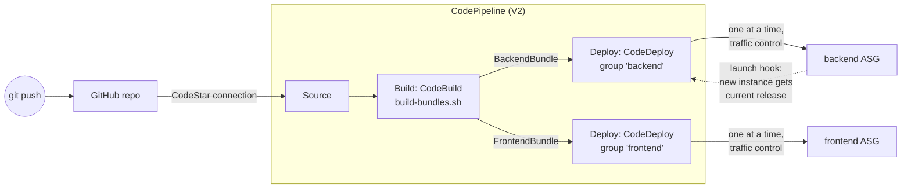

# 14 — CI/CD with AWS CodePipeline → Auto Scaling Groups

> Lesson 13's fleets got their app from `user_data` pulling a zip that
> Terraform uploaded. That's not a delivery pipeline — every release meant
> a `terraform apply`. Here a `git push` builds the app (CodeBuild) and
> rolls it onto both Auto Scaling Groups one instance at a time
> (CodeDeploy), orchestrated by CodePipeline — all created by Terraform.

> **Status of this lesson's verification — read first.** The CodeDeploy
> half (deployment to both ASGs, automatic deployment to new instances,
> zero-downtime rolling update, automatic rollback) is verified live below
> with real output. The CodeBuild stage could **not** run on the AWS
> account used to write this course — see §3 "Prerequisite: the CodeBuild
> account limit". The pipeline's Source stage was verified; the full
> push → build → deploy run is pending AWS lifting that limit.

## 1. CI/CD challenges with Auto Scaling Groups

Deploying to one server is easy: SSH in (or SSM), copy files, restart.
With an ASG, three things break that model:

| Challenge | Why it bites | How this lesson handles it |
|---|---|---|
| **Instances come and go** | A deploy that targets "the servers" by IP misses the instance the ASG launches 5 minutes later — it boots the *old* version | The deployment group targets the **ASG itself**; CodeDeploy installs a launch lifecycle hook so every new instance gets the current release before it serves traffic (§5.2) |
| **The very first deploy** | A brand-new ASG has instances but no app yet; with ELB health checks the ASG kills them as "unhealthy" before any deploy reaches them | `health_check_grace_period = 600` (vs 180 in lesson 13) covers the first pipeline run — §2 |
| **Deploying = taking capacity away** | Restarting the app on an instance still in the load balancer drops users' requests | In-place deploy **with traffic control**: deregister → drain → deploy → validate → re-register, one instance at a time (§5.3) |
| **Bad releases** | A broken build rolled to every instance is a full outage | `ValidateService` hook gates each instance; first failure stops the rollout and **auto-rollback** redeploys the last good revision (§5.4) |

## 2. Architecture



The infrastructure is lesson 13's, with one deliberate change — **the app
is no longer in `user_data`**:

| | 13-auto-scaling-groups | This lesson |
|---|---|---|
| `user_data` (backend) | fetch secret, download app zip, write `.env`, migrate, start PM2 | **only** writes `/etc/three-tier/app.env` (region, DB host, secret ARN) — facts Terraform knows and the pipeline doesn't |
| `user_data` (frontend) | download build, configure Nginx | configure Nginx only |
| Who delivers the app | Terraform (`aws_s3_object`) + boot script | CodeDeploy, from the pipeline's artifact bucket |
| A new release means | `terraform apply` → instance refresh | `git push` |

Infrastructure facts vs. application facts is the dividing line: Terraform
owns what the environment *is*; the pipeline owns what *runs* on it.

## 3. What Terraform creates — `pipeline.tf`

Read [`pipeline.tf`](pipeline.tf) top to bottom; it's commented for class:

- **`aws_codebuild_project`** — runs [`deploy/buildspec.yml`](deploy/buildspec.yml),
  which calls [`deploy/build-bundles.sh`](deploy/build-bundles.sh). One
  commit becomes two **CodeDeploy revisions**:

  ```
  bundle/backend/   appspec.yml  scripts/  app/{src,node_modules,VERSION,...}
  bundle/frontend/  appspec.yml  scripts/  site/{index.html,assets,version.txt}
  ```

  `node_modules` is installed *in the build*, on Linux x86_64 like the
  instances — a deploy never touches the npm registry.

- **`aws_codedeploy_deployment_group`** (×2, `for_each`) — the important one:

  ```hcl
  autoscaling_groups     = [each.value.asg]                 # target the ASG, not instances
  deployment_config_name = "CodeDeployDefault.OneAtATime"
  deployment_style {
    deployment_option = "WITH_TRAFFIC_CONTROL"              # deregister/re-register around each instance
    deployment_type   = "IN_PLACE"
  }
  auto_rollback_configuration {
    enabled = true
    events  = ["DEPLOYMENT_FAILURE"]
  }
  outdated_instances_strategy = "UPDATE"                    # instances launched mid-deploy get the new revision too
  ```

- **`aws_codepipeline`** (`pipeline_type = "V2"`) — Source → Build → Deploy
  (backend and frontend deploy in parallel). The **trigger** only fires on
  pushes that touch app code:

  ```hcl
  file_paths {
    includes = ["frontend/**", "backend/**", "database/**", "14-cicd-codepipeline/deploy/**"]
  }
  ```

  A README-only commit doesn't redeploy anything.

- **Three IAM roles** (CodeBuild, CodeDeploy, CodePipeline), each scoped
  to its bucket/project/connection — plus the instance role now reads the
  pipeline's artifact bucket, because the **CodeDeploy agent on each
  instance downloads the revision itself**. (The agent has been in the
  AMI since [lesson 12](../12-golden-ami/) for exactly this.)

### The per-instance script — `appspec.yml`

[`deploy/backend/appspec.yml`](deploy/backend/appspec.yml) plus four hook
scripts. With traffic control on, the full sequence on each instance is:

```
BlockTraffic        ← CodeDeploy: deregister from the target group, wait for drain
ApplicationStop     scripts/application_stop.sh    pm2 delete backend
(install)           copy app/ → /opt/app/backend
AfterInstall        scripts/after_install.sh       secret → .env (APP_VERSION from bundle), migration
ApplicationStart    scripts/application_start.sh   pm2 start
ValidateService     scripts/validate_service.sh    /health must report THIS version within 60s
AllowTraffic        ← CodeDeploy: re-register, wait for healthy
```

`/health` now returns the deployed version
(`{"status":"ok","version":"<commit>"}`), so every test below can prove
*which* release each instance runs.

### Prerequisite: the CodeBuild account limit

The first pipeline run (CodePipeline starts one automatically when it's
created) failed at Build:

```console
$ aws codepipeline get-pipeline-state --name three-tier-terraform-14 \
    --query 'stageStates[?stageName==`Build`].actionStates[0].latestExecution'
"status": "Failed",
"errorDetails": {
  "code": "JobFailed",
  "message": "Error calling startBuild: Cannot have more than 0 builds in queue for the account
              (Service: AWSCodeBuild; Status Code: 400; Error Code: AccountLimitExceededException)"
}
```

Service Quotas *claims* otherwise — which is what makes this confusing:

```console
$ aws service-quotas list-service-quotas --service-code codebuild ...
Concurrently running builds for Linux/Small environment        15.0
Concurrently running builds for Linux Lambda/2GB environment   15.0
```

…and trying a different compute type (Lambda) hits the same wall:

```console
An error occurred (AccountLimitExceededException) when calling the StartBuild operation:
Cannot have more than 0 concurrent builds on LINUX_LAMBDA_CONTAINER machines with the
BUILD_LAMBDA_2GB compute type for the account
```

Newer or low-usage AWS accounts can carry a hidden account-level CodeBuild
limit of **0** that the Service Quotas console doesn't show. The fix is an
**AWS Support case** ("Service limit increase" → CodeBuild → concurrent
builds). Expect students on new accounts to hit this — check it *before*
class with one `aws codebuild start-build`.

Until it's lifted, [`deploy/manual-deploy.sh`](deploy/manual-deploy.sh)
does exactly what the Build and Deploy stages do — same
`build-bundles.sh`, same CodeDeploy deployment groups — from your laptop.
Everything in §5 was run that way. (Or skip CodeBuild entirely:
[lesson 15](../15-github-actions-asg/) builds and deploys with GitHub
Actions only.)

## 4. Run it

```bash
# once: the GitHub connection (needs a human click — see its main.tf)
cd 14-cicd-codepipeline/github-connection
cp backend.hcl.example backend.hcl
terraform init -backend-config=backend.hcl && terraform apply
# → AWS Console → CodePipeline → Settings → Connections →
#   three-tier-terraform-github → Update pending connection → Connect

cd ..
cp backend.hcl.example backend.hcl
cp terraform.tfvars.example terraform.tfvars   # set github_repo to your fork
terraform init -backend-config=backend.hcl
terraform apply                                 # lesson 12's AMI must exist
```

Real output:

```console
Apply complete! Resources: 60 added, 0 changed, 0 destroyed.

Outputs:
app_url = "http://three-tier-tf-14-alb-2029068869.ap-southeast-1.elb.amazonaws.com"
codedeploy_app = "three-tier-terraform-14"
github_connection_status = "AVAILABLE"
pipeline_name = "three-tier-terraform-14"
```

## 5. Testing it — every exercise below was run live

All tests used the same probe: `/health` (backend target group) and
`/version.txt` (frontend target group) once a second, logging status code
and version.

### 5.1 First deploy to an empty fleet

```console
$ bash 14-cicd-codepipeline/deploy/manual-deploy.sh m1-d2665c2
bundles for m1-d2665c2 ready in ./bundle
backend: d-U780B5JOL
frontend: d-XCHVJ7JOL

$ aws deploy get-deployment --deployment-id d-U780B5JOL --query 'deploymentInfo.[status,deploymentOverview]'
"Succeeded"   {"Succeeded": 2, "Failed": 0, "Skipped": 0}       ← 16:41:13 → 16:44:08
```

```console
$ curl $APP_URL/health                    (×4 — different instances each time)
{"status":"ok","version":"m1-d2665c2"}
$ curl $APP_URL/version.txt
m1-d2665c2
$ curl $APP_URL/api/v1/history
{"rows":[{"city":"Dhaka",...,"queried_at":"2026-10-11T10:44:34.399Z"}]}
```

CodeDeploy also did something to the ASG on its own:

```console
$ aws autoscaling describe-lifecycle-hooks --auto-scaling-group-name three-tier-terraform-14-backend
CodeDeploy-managed-automatic-launch-deployment-hook-backend-e9493ebf...   autoscaling:EC2_INSTANCE_LAUNCHING   ABANDON   600
```

That hook is what §5.2 is about.

### 5.2 Auto-deploy to a new instance

Simulate a scale-out:

```console
$ aws autoscaling set-desired-capacity --auto-scaling-group-name three-tier-terraform-14-backend --desired-capacity 3

16:45:03 i-0b188f65e4c902791:Pending:Wait  i-0dd0...:InService  i-0f23...:InService
  ...                                                   ← held by the lifecycle hook
16:46:41 i-0b188f65e4c902791:InService     i-0dd0...:InService  i-0f23...:InService
```

```console
$ aws deploy get-deployment --deployment-id d-DVQQ82JOL \
    --query 'deploymentInfo.[creator,status,description]'
autoscaling   Succeeded
"Instance i-0b188f65e4c902791 was launched by Auto Scaling group three-tier-terraform-14-backend
 hook CodeDeploy-managed-automatic-launch-deployment-hook-backend-..."

$ # on the new instance (via SSM)
$ curl -s localhost:3000/health
{"status":"ok","version":"m1-d2665c2"}
```

Nobody ran a deploy. The ASG launched an instance, the hook held it in
`Pending:Wait` (~1m40s), **CodeDeploy deployed the last successful
revision to it** (creator: `autoscaling`), and only then did it go
InService and join the target group. A scale-out, a self-healing
replacement or an instance refresh all get the current release this way —
the "instances come and go" challenge from §1, solved.

> **Try it:** `set-desired-capacity` to 3, then
> `aws deploy list-deployments --application-name three-tier-terraform-14 --deployment-group-name backend`
> — a new deployment appears that you didn't create.

### 5.3 Zero-downtime rolling update

Deploy `m2-rolling` with the probe running:

```console
$ bash 14-cicd-codepipeline/deploy/manual-deploy.sh m2-rolling
backend: d-RUJ1QPIOL      frontend: d-KKSCFIJOL

# per-instance timing, backend (first lifecycle event → last)
i-0dd0c26acf47f562e   16:47:46 → 16:49:08
i-0b188f65e4c902791   16:49:08 → 16:50:29
i-0f2397e64083b5115   16:50:30 → 16:51:52
```

Strictly **one instance at a time**, ~80 s each. The probe:

```console
840 responses, 840 × 200          (420 backend + 420 frontend over 7 minutes)

backend version seen, per minute:
  16:47   m1 ×36
  16:48   m1 ×37   m2 ×5
  16:49   m1 ×22   m2 ×20
  16:50   m1 ×9    m2 ×33
  16:51   m2 ×42
```

Zero failed requests. But look at 16:48–16:50: **users were served both
versions at the same time** — a request could hit `m1` and the next one
`m2`. That's inherent to every rolling deploy, and it has a real
consequence: **v1 and v2 must be compatible with each other** (API shape,
DB schema, cache formats). When they can't be — say, a migration that
drops a column v1 still reads — you need blue/green instead (all traffic
switches at once) — built and measured in
[16 — Blue/Green Deployment](../16-blue-green-deployment/).

### 5.4 Automatic rollback — break it on purpose

The exercise for students: make `/health` fail, ship it, watch AWS undo it.

```diff
 app.get('/health', (req, res) => {
-  res.json({ status: 'ok', version: process.env.APP_VERSION || 'unknown' });
+  res.status(500).json({ status: 'broken', version: process.env.APP_VERSION || 'unknown' });
 });
```

Ship it as `m3-broken` (via `git push` once CodeBuild works, or
`manual-deploy.sh m3-broken`), probe running:

```console
$ aws deploy get-deployment --deployment-id d-7AS4C6JOL
"status": "Failed",
"errorInformation": { "code": "HEALTH_CONSTRAINTS", ... },
"rollbackInfo": {
  "rollbackDeploymentId": "d-UCMDHYIOL",
  "rollbackMessage": "Deployment d-7AS4C6JOL terminated. Automatic rollback is triggered with a DeploymentId d-UCMDHYIOL."
},
"deploymentOverview": { "Succeeded": 0, "Failed": 1, "Skipped": 1 }

i-0b188f65e4c902791   Failed    ValidateService: scripts/validate_service.sh run as user root failed with exit code 1
i-0f2397e64083b5115   Skipped
```

Read it in order:

1. The first instance got `m3-broken`; its `ValidateService` hook waited 60 s
   for `/health` to report the new version with HTTP 200 — it got 500s.
2. That instance **failed** and was **never re-registered** with the
   target group.
3. With `OneAtATime`, one failure means the deployment can't meet its
   health constraint → the remaining instance was **skipped**.
4. Auto-rollback created a new deployment of the last good revision:

```console
$ aws deploy get-deployment --deployment-id d-UCMDHYIOL \
    --query 'deploymentInfo.[status,creator,createTime,completeTime]'
Succeeded   codeDeployRollback   16:59:52   17:01:17

$ # on the instance that had failed
$ curl -s localhost:3000/health
{"status":"ok","version":"m2-rolling"}
```

And what users experienced during all of it:

```console
960 responses, 960 × 200
backend versions seen: m2-rolling ×480  (m3-broken: never)
```

**Not one user ever saw the broken release.** The only instance that ran
it was out of the load balancer the whole time. That's the payoff of
traffic control + a real `ValidateService` check: a bad deploy costs one
instance's worth of capacity for ~2 minutes, not an outage.

> **Weak validation = no protection.** If `validate_service.sh` only
> checked "is port 3000 open?", the broken build would have passed, been
> re-registered, and served 500s while CodeDeploy moved on to the next
> instance. The hook is only as good as what it checks.

## 6. Zero-downtime techniques — what this lesson used

| Technique | Where | Effect seen |
|---|---|---|
| Deregister before deploy (traffic control) | deployment group `WITH_TRAFFIC_CONTROL` | No request ever reached an instance mid-deploy |
| Connection draining | target group `deregistration_delay = 30` | In-flight requests finished before the app stopped |
| One instance at a time | `CodeDeployDefault.OneAtATime` | Capacity never dropped below N-1 |
| Health-gated rollout | `ValidateService` hook | Broken build stopped at instance #1 |
| Automatic rollback | `auto_rollback_configuration` | Last good release restored in 85 s, no human |
| New instances get current code | ASG-attached deployment group (lifecycle hook) | Scale-out instance served `m1` without a manual deploy |

What it doesn't solve: two versions live at once (§5.3) — blue/green's job.

## 7. Clean up

```bash
terraform destroy                       # pipeline + fleet
cd github-connection && terraform destroy   # only if you won't use the connection again
```

The artifact bucket has `force_destroy = true`, so its revisions go with
it. Destroy this lesson before lesson 12 (its AMI) and the bootstrap.

## If it breaks

- **Build: `AccountLimitExceededException ... more than 0 builds`** — §3.
  Support case, or `manual-deploy.sh` / lesson 15 meanwhile.
- **Source: `Unable to use Connection`** — the connection is still
  `PENDING`; approve it in the console (§4).
- **Deployment stuck, instances `Pending:Wait`, then terminated** — the
  launch hook waits up to 600 s for CodeDeploy, then `ABANDON`s the
  instance. Check the deployment's per-instance events:
  `aws deploy list-deployment-targets` → `get-deployment-target`.
- **`Script ... is not executable`** — a bundle zipped on Windows without
  the executable bit. `build-bundles.sh` `chmod +x`es the scripts and
  `manual-deploy.sh` zips with explicit `0755`; a hand-made zip won't.
- **`ApplicationStop` fails on the first-ever deploy** — it runs the
  *previous* revision's script; there is none on a fresh instance, which
  is why `application_stop.sh` ends with `exit 0`.
- **CodeDeploy agent errors about credentials** — the instance role must
  read the pipeline's artifact bucket (`s3_read_arns` in `main.tf`).

## Next

**[15 — Deploy to ASGs with GitHub Actions only](../15-github-actions-asg/)**
