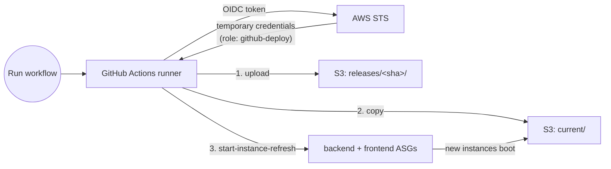

# 15 — Deploy to Auto Scaling Groups with GitHub Actions only

> The same fleet as lessons 13/14, deployed with **no AWS CI/CD services at
> all** — no CodePipeline, no CodeBuild, no CodeDeploy. GitHub Actions
> builds the app, logs into AWS without stored keys (OIDC), publishes a
> release to S3, and replaces every instance with an ASG instance refresh.

> **Verification status.** Build-and-deploy through the workflow was run
> live: 634/634 requests succeeded during the rollout (§5). The rollback
> procedure (§6) is the same workflow with one input set; it was not
> re-run separately on the course account.

## 1. Why a second approach

[Lesson 14](../14-cicd-codepipeline/) used AWS's own tools. This lesson is
what many teams actually run when their code already lives on GitHub:

| | 14 — CodePipeline + CodeDeploy | 15 — GitHub Actions only |
|---|---|---|
| Where the build runs | CodeBuild | GitHub-hosted runner |
| How a release reaches instances | CodeDeploy agent, **in place** on running instances | New instances boot the release — old ones are **replaced** (immutable) |
| New instances get the current version | CodeDeploy lifecycle hook | Automatically — `user_data` always boots `current/` |
| Rollback | CodeDeploy redeploys last good revision | Point `current/` at an older release, refresh again — no rebuild |
| AWS services to set up | CodePipeline, CodeBuild, CodeDeploy, connection | One S3 bucket + one IAM role |
| AWS credentials in GitHub | None (connection) | None (OIDC) |
| Works on this course's AWS account | Build stage blocked by an account limit (lesson 14 §3) | Yes |

Neither is "the right one". In-place (14) is faster per release; immutable
(15) never leaves an instance half-upgraded and makes "what is running"
trivially answerable: whatever `current/` points at.

## 2. Architecture



### The release bucket layout

```
s3://three-tier-terraform-15-releases-<account>/
  releases/2524892/backend.zip     ← every build, kept
  releases/2524892/frontend.zip
  releases/e504193/...
  current/backend.zip              ← a copy of whichever release is live
  current/frontend.zip
```

Every instance's `user_data` ([backend](user_data_backend.sh.tpl),
[frontend](user_data_frontend.sh.tpl)) downloads `current/` at boot. So
**deploying is two steps**: change what `current/` holds, then replace the
instances. Scale-outs and self-healing replacements pick up the current
release for free.

## 3. Logging into AWS without keys — OIDC

[`github.tf`](github.tf) creates:

- **The GitHub OIDC provider** — tells AWS to trust tokens signed by
  `token.actions.githubusercontent.com`. One per account; set
  `create_github_oidc_provider = false` if yours already has it.
- **`three-tier-terraform-15-github-deploy`** — the role the workflow
  assumes. Its trust policy only accepts tokens for **this repo, on the
  allowed branches**:

  ```hcl
  StringLike = {
    "token.actions.githubusercontent.com:sub" = [
      "repo:OWNER/REPO:ref:refs/heads/main",
      "repo:OWNER@ID/REPO@ID:ref:refs/heads/main",   # immutable form — see below
    ]
  }
  ```

  A fork, a different repo, or a different branch is refused by AWS.
- **A least-privilege policy** — put objects in the release bucket, start
  and watch instance refreshes on exactly these two ASGs. No EC2, no IAM,
  no Terraform state.

### Common pitfall: GitHub's immutable OIDC subject

**You'll see** the workflow fail at login:

```console
Run aws-actions/configure-aws-credentials@v4
Error: Could not assume role with OIDC: Not authorized to perform sts:AssumeRoleWithWebIdentity
```

**Why:** most tutorials write the trust policy for the classic token
subject, `repo:OWNER/REPO:ref:refs/heads/...`. Newer GitHub repos send the
**immutable** format instead — check yours:

```console
$ gh api repos/ashikMostofaTonmoy/three-tier-terraform/actions/oidc/customization/sub
{"use_default":true,"use_immutable_subject":true,
 "sub_claim_prefix":"repo:ashikMostofaTonmoy@43008495/three-tier-terraform@1369295421"}
```

The numeric IDs mean a repo deleted and re-created with the same name
can't inherit the trust — a security feature, but it silently breaks the
classic pattern.

**This lesson's code** accepts both formats; you pass your repo's prefix
in `terraform.tfvars`:

```hcl
github_immutable_sub_prefix = "repo:OWNER@OWNER_ID/REPO@REPO_ID"   # from the gh api command above
```

## 4. The workflow — `.github/workflows/asg-deploy.yml`

[`.github/workflows/asg-deploy.yml`](../.github/workflows/asg-deploy.yml),
step by step:

1. **Decide what to deploy** — no input = build this commit (short SHA);
   `release` input = roll back to an existing release.
2. **Log into AWS** — `aws-actions/configure-aws-credentials` with
   `role-to-assume`; the job has `permissions: id-token: write`.
3. **Build bundles** — the same
   [`build-bundles.sh`](../14-cicd-codepipeline/deploy/build-bundles.sh)
   lesson 14's CodeBuild runs (one build script, two pipelines).
4. **Publish** `releases/<sha>/`, then **copy it to `current/`**.
5. **Replace instances** on both ASGs:

   ```bash
   aws autoscaling start-instance-refresh --auto-scaling-group-name "$ASG" \
     --preferences '{"MinHealthyPercentage":100,"MaxHealthyPercentage":150,"InstanceWarmup":60}'
   ```

   `MinHealthyPercentage: 100` = never drop below full capacity;
   `MaxHealthyPercentage: 150` = may temporarily run 1.5× capacity. Together
   they mean **launch the new instance, wait until it's healthy, then retire
   an old one** — the opposite order from lesson 13's refresh (50%), which
   terminated first.
6. **Wait** for both refreshes to report `Successful`.
7. **Smoke test** through the load balancer: `/health` must report the new
   SHA, `/version.txt` too — 10 times in a row.

`concurrency: asg-deploy` queues a second deploy instead of letting two
refreshes collide. The push trigger is commented out — this repo is a
course, most pushes are lessons, and the stack usually isn't running.
Uncomment it to deploy on every push to `main` that touches the app.

## 5. Run it

```bash
cd 15-github-actions-asg
cp backend.hcl.example backend.hcl
cp terraform.tfvars.example terraform.tfvars
# terraform.tfvars: github_repo = "<you>/three-tier-terraform"
#                   github_immutable_sub_prefix = output of:
#   gh api repos/<you>/three-tier-terraform/actions/oidc/customization/sub --jq .sub_claim_prefix
terraform init -backend-config=backend.hcl
terraform apply                     # lesson 12's AMI must exist
```

The apply prints the six values the workflow reads. Store them as
**repository variables** (not secrets — nothing in them is sensitive):

```bash
terraform output -json github_variables | python3 -c "
import json, sys, subprocess
for k, v in json.load(sys.stdin).items():
    subprocess.run(['gh', 'variable', 'set', k, '--body', v, '--repo', '<you>/three-tier-terraform'], check=True)"
```

…or paste them under **Settings → Secrets and variables → Actions →
Variables**. Then: **Actions → "Deploy to ASGs (GitHub Actions only)" →
Run workflow** (or `gh workflow run asg-deploy.yml`).

> **Brand-new stack:** the ASGs launch before any release exists. Their
> `user_data` waits up to 4 minutes for `current/` to appear; if none
> exists yet, the boot fails and the ASG replaces the instance until one
> does. Run the workflow right after `terraform apply`. (Why not simply a
> long grace period instead? It blocks every instance refresh — see the
> pitfall in [lesson 16 §9.7](../16-blue-green-deployment/README.md).)

### Common pitfall: `aws s3 ls` with a least-privilege role

The natural way to wait for a file in S3 is `aws s3 ls`. With this
lesson's instance role, **you'll see** every instance loop on:

```console
An error occurred (AccessDenied) when calling the ListObjectsV2 operation: ...
is not authorized to perform: s3:ListBucket on resource: "arn:aws:s3:::three-tier-terraform-15-releases-..."
```

**Why:** `aws s3 ls` needs `s3:ListBucket`; the instance role deliberately
only has `s3:GetObject`.

**This lesson's code** uses `aws s3api head-object --bucket ... --key current/backend.zip`,
which needs only `GetObject`. The right fix is the command, not a wider
policy — least privilege doing its job.

### A real run

Dispatched with the probe running (`/health` and `/version.txt`, once a
second):

```console
$ gh workflow run asg-deploy.yml
Set up job ............................. 11:52:51 → 11:52:52
configure-aws-credentials (OIDC) ........ 11:52:53 → 11:52:54
Build bundles .......................... 11:52:58 → 11:53:01
Publish release ........................ 11:53:01 → 11:53:09
Point current/ at the release .......... 11:53:09 → 11:53:13
Replace instances ...................... 11:53:13 → 11:53:15
Wait for both refreshes ................ 11:53:15 → 12:00:11
Smoke test through the load balancer ... 12:00:11 → 12:00:19
conclusion: success                       (7 min 37 s total)
```

Everything on GitHub's side took ~22 s; the other ~7 minutes is instances
booting and passing health checks. Launch-before-terminate, from the ASG's
own activity log:

```console
11:53:23  Launching a new EC2 instance: i-0322641af4b2f6322     ← new first
11:56:09  Terminating EC2 instance: i-0ffec4654d5df7273         ← old only after the new one is healthy
11:56:10  Launching a new EC2 instance: i-069e79de4d23322ce
11:58:10  Terminating EC2 instance: i-0c948ce6ef135353b
```

And what users saw, backend version per minute (UTC, same clock as the
workflow steps above):

```console
11:53   e504193 ×42
11:54   e504193 ×34   2524892 ×8      ← new instance joins the target group
11:56   e504193 ×23   2524892 ×19
11:58   e504193 ×3    2524892 ×39
11:59                 2524892 ×41
probe: 634 responses, 634 × 200
```

Zero failures. Note the mixed minutes: like any rolling replacement, old
and new versions serve side by side for a few minutes — the same
compatibility caveat as lesson 14 §5.3.

## 6. Rollback

Every release stays in `releases/`, so rolling back is re-pointing and
refreshing — no rebuild:

```bash
gh workflow run asg-deploy.yml -f release=e504193
```

The workflow skips the build, copies `releases/e504193/` over `current/`,
refreshes both ASGs the same launch-before-terminate way, and the smoke
test checks that `e504193` is what the load balancer serves. A typo'd SHA
fails at the copy step — before any instance is touched.

**Exercise:** deploy twice (two different commits), then roll back to the
first with the probe from §5 running, and confirm the version in
`/health` switches back with no failed requests.

## 7. Clean up

```bash
terraform destroy
gh variable delete AWS_REGION --repo <you>/three-tier-terraform   # and the other five
```

Or, at the end of class, the repo-wide script removes everything
including the repo variables:

```bash
bash scripts/cleanup-everything.sh --yes --github-repo <you>/three-tier-terraform
```

See the root README's **Cleaning up after every class**.

## If it breaks

- **`Not authorized to perform sts:AssumeRoleWithWebIdentity`** — the
  workflow ran on a branch not in `github_branches`, or the repo uses the
  immutable subject and `github_immutable_sub_prefix` is empty (§3).
- **Refresh stuck at `InProgress`, targets unhealthy** — check one
  instance's boot log over SSM:
  `aws ssm send-command --instance-ids <id> --document-name AWS-RunShellScript --parameters 'commands=["tail -30 /var/log/user-data.log"]'`.
- **`An Instance Refresh is already in progress`** — a previous run (or a
  `terraform apply` that changed the launch template) is still refreshing.
  Wait, or `aws autoscaling cancel-instance-refresh`.
- **Smoke test fails but the refresh succeeded** — the release that was
  copied to `current/` isn't the one you expect; compare
  `aws s3 ls s3://<bucket>/releases/` with the workflow's "Decide what to deploy" step.

## Next

**[16 — Blue/Green Deployment with GitHub Actions](../16-blue-green-deployment/)** —
two full backend fleets and an all-at-once traffic switch, with a
seconds-long rollback.
