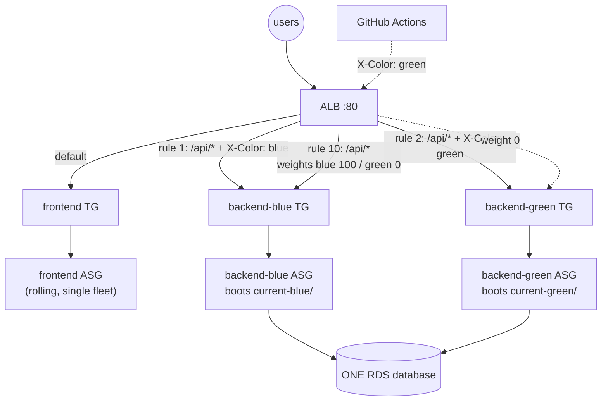
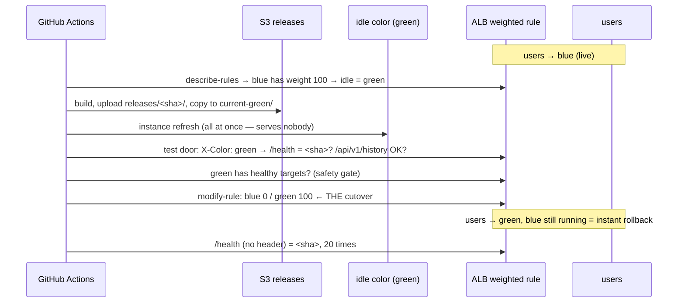

# 16 — Blue/Green Deployment with GitHub Actions

> Two complete backend fleets — **blue** and **green** — behind one load
> balancer. Users only ever reach one of them. A new release goes onto the
> other one, gets tested there through the real load balancer while users
> notice nothing, and then **all** traffic moves in a single API call.
> Rolling back is the same call in reverse — seconds, no rebuild, no
> redeploy. Driven entirely by GitHub Actions; infrastructure by Terraform.

## 1. Theory — deployment strategies, and where blue/green fits

Every deployment answers three questions: *Is the app ever down? Do users
ever hit two versions at once? How fast can I undo it?* Each strategy
trades those against cost:

| Strategy | How | Downtime | Two versions live at once? | Rollback | Extra cost | In this repo |
|---|---|---|---|---|---|---|
| **Recreate** | Stop everything, start the new version | **Yes** | No | Redeploy old version (minutes) | None | lessons 05-11 (`terraform apply` replaced instances) |
| **Rolling, in place** | Update instances one at a time | No | **Yes**, for minutes | Redeploy old version (minutes) | None | [14](../14-cicd-codepipeline/) (CodeDeploy) |
| **Rolling, immutable** | Replace instances one at a time with new ones | No | **Yes**, for minutes | Re-point + replace again (minutes) | Briefly +50% | [15](../15-github-actions-asg/) (instance refresh) |
| **Blue/green** | Build a full second environment, then switch all traffic | No | **No** — one switch moment | **Switch back (seconds)** | **2× the tier**, at least during the deploy | **this lesson** |
| **Canary** | Send a small % of traffic to the new version, increase gradually | No | Yes, *on purpose*, small % | Set the % back to 0 (seconds) | Small | §8 — same mechanism as this lesson |

The two columns blue/green wins are **no mixed versions** and **instant
rollback**. Rolling deploys can't offer either: during a rolling deploy
some users are on v1 and some on v2 ([lesson 14 §5.3](../14-cicd-codepipeline/README.md)
measured it — `m1` and `m2` interleaved for three minutes), and undoing
one means deploying again.

### When it's worth the cost

- The release changes an **API contract** the frontend or other services
  depend on, and you can't have both versions answering at once.
- **Rollback speed matters** more than money — the previous version should
  be one click away, already warm.
- You want to **test the exact production build, on production
  infrastructure, before any user touches it** (§4, the test door).

When it isn't: a static frontend whose old and new files work with the
same backend. That's why this lesson does blue/green for the **backend
only** and keeps the frontend on a cheap rolling replacement (§5).

### Vocabulary

- **Live** color — receives 100% of user traffic.
- **Idle** color — receives none; it's where the next release goes.
- **Cutover** — the moment traffic moves from live to idle.
- **Bake time** — how long you keep the old color running after cutover,
  as the instant-rollback option.

## 2. Where to do the switch

The switch has to sit somewhere *in front of* both fleets:

| Switch point | How | Problem |
|---|---|---|
| **DNS** (e.g. Route 53 weighted records) | Point the hostname at the other environment | Clients and resolvers **cache DNS** for the record's TTL — "switched" users keep reaching the old one for minutes; rollback is just as slow |
| **CodeDeploy blue/green** (`COPY_AUTO_SCALING_GROUP`) | CodeDeploy *copies* your ASG into a new one, deploys there, moves the target group, deletes the old ASG | The ASG Terraform created gets **deleted and replaced by one Terraform has never heard of** — the next `terraform plan` wants to recreate it. Workable, but you must stop managing that ASG with Terraform |
| **Load balancer weights** ← this lesson | One listener rule forwards to two target groups by weight; change the weights | None of the above: takes effect for new requests within seconds, no DNS, and Terraform keeps owning every resource |

## 3. Architecture



What's new compared to lesson 15, all in [`main.tf`](main.tf) and
[`modules/alb-blue-green`](modules/alb-blue-green/main.tf):

- **Two backend ASGs**, created with `for_each = toset(["blue", "green"])`
  on the same `asg` module. Identical except their color: each boots
  from its **own** release pointer (`current-blue/` or `current-green/`)
  and registers into its **own** target group.
- **One weighted listener rule** (priority 10) — `/api/*` and `/health`
  forward to *both* target groups, by weight:

  ```hcl
  action {
    type = "forward"
    forward {
      target_group { arn = aws_lb_target_group.backend["blue"].arn,  weight = 100 }
      target_group { arn = aws_lb_target_group.backend["green"].arn, weight = 0 }
    }
  }
  lifecycle {
    ignore_changes = [action]   # the workflow owns the weights from here on
  }
  ```

- **Two header rules** (priorities 1 and 2) — the **test door**: a request
  carrying `X-Color: green` goes to the green fleet regardless of weights.
  Users never send that header; the pipeline (and you, with `curl`) do.
- **One database, shared.** Blue/green duplicates the *stateless* tier.
  Data can't be duplicated and switched — see §6 for what that implies.
- **One frontend fleet** — rolled, not blue/greened (§5).

### Who owns what: Terraform vs. the pipeline

Terraform creates the rule with blue at 100. From then on the **workflow**
moves the weights — that's the deployment. `ignore_changes = [action]` is
what makes that safe: without it, the next `terraform apply` would
"correct" the weights back to blue = 100 and silently undo a deployment
(§9.8 checks this for real).

## 4. The workflow — `.github/workflows/blue-green-deploy.yml`

[`.github/workflows/blue-green-deploy.yml`](../.github/workflows/blue-green-deploy.yml)
has three modes (Actions → "Blue/green deploy (GitHub Actions)" → Run workflow):

### `deploy` — the blue/green sequence



1. **Find the live color** by reading the rule's weights — the workflow
   keeps no state of its own; the load balancer *is* the source of truth.
2. **Build and publish** the release (same `build-bundles.sh` as lessons
   14 and 15), then copy it to the **idle** color's pointer.
3. **Replace the idle fleet all at once** (`MinHealthyPercentage: 0`). In
   lessons 13-15 that setting would have taken the site down; here the
   idle color serves no users, so the fastest replacement is also safe.
4. **Test through the test door**: `/health` must report the new SHA and
   `/api/v1/history` must succeed — a real request through the new code to
   the shared database — all while 100% of users stay on the live color.
5. **Safety gate**: refuse to switch if the idle target group has no
   healthy targets.
6. **Cutover**: one `aws elbv2 modify-rule` call sets idle = 100, live = 0.
7. **Verify** from the user's side (no header): wait until 20 requests in a
   row return the new SHA — the ALB takes 7-12 s to apply new weights (§9.7).
8. **Roll the frontend** (rolling, launch-before-terminate — §5).

### `switch-back` — rollback

Reads the weights, flips them to the other color. Nothing is built,
nothing is replaced: the previous release has been running on that color
the whole time.

### `bootstrap` — first run only

On a brand-new stack neither color has a release yet. Bootstrap installs
the same release on **both** colors and the frontend, with blue live.

### Permissions

[`github.tf`](github.tf) is lesson 15's OIDC setup plus exactly one new
permission — `elasticloadbalancing:ModifyRule`, **on the weighted rule's
ARN only**. The workflow can move traffic between blue and green and do
nothing else to the load balancer.

### Seeing which color is live — three places to look

`curl` proves it, but in class you want to **see** it. Keep these open
while you run a deploy or a switch-back:

**1. The app itself.** The page footer shows which backend answered, as a
colored badge — refreshed every 3 seconds, no reload needed:

> build `74423bd` · API **`BLUE`** `74423bd`

The backend reports its own color (`APP_COLOR`, written into `.env` by
each color's `user_data`) and version:

```console
$ curl $APP_URL/health
{"status":"ok","version":"74423bd","color":"blue"}
```

At the cutover the badge flips from one color to the other, and never
flickers back. To look at the **idle** color without switching anyone,
use the test door: `curl -H "X-Color: green" $APP_URL/health`.

**2. The CloudWatch dashboard** (created by [`dashboard.tf`](dashboard.tf);
the URL is a Terraform output: `terraform output dashboard_url`).
CloudWatch → Dashboards → `three-tier-terraform-16-blue-green`:

- *Requests per color* — the live color has all the traffic, the idle one
  has none. **A deploy shows up as the two lines crossing.**
- *Healthy instances per color* — both colors stay at 2: the idle color is
  running and ready, it just serves nobody. That's what makes rollback
  instant.
- *Backend errors (5xx) per color* — should stay at zero through a switch.

The data behind those lines, from a real deploy (requests per minute, UTC;
the workflow logged `switched: blue=100 green=0 at 17:53:12`):

```console
UTC     blue   green
17:51     0     256      ← green live
17:52     0     259
17:53   191     127      ← the switch, mid-minute
17:54   257       0      ← blue live
17:55   256       0
```

CloudWatch metrics arrive in 1-minute buckets and a couple of minutes
late — the dashboard confirms what happened; the badge shows it live.

**3. The load balancer itself — the source of truth.** EC2 → Load
Balancers → `three-tier-tf-16-alb` → **Listeners and rules** → HTTP:80 →
the rule for `/api/*, /health` shows the two target groups and their
**weights** (e.g. `be-blue 100 %`, `be-green 0 %`). That *is* the switch:
the workflow changes exactly these two numbers. Then EC2 → **Target
groups** → `three-tier-tf-16-be-blue` / `-be-green` → **Targets** (both
healthy) and **Monitoring** (only the live one has requests).

## 5. Why the frontend isn't blue/green here

The frontend is static files. Old and new builds both call the same
`/api/*` paths, so a user who loads the old page and then hits the new
backend (or vice versa) is fine — **as long as the API change is
backward-compatible**, which §6 requires anyway. A second frontend fleet
would cost money and buy nothing. The workflow rolls it *after* the
backend cutover, so new pages always meet a backend that already serves
the new API.

When would you blue/green the frontend too? When old and new frontends
genuinely can't coexist with the same backend — then you'd put a
`blue`/`green` pair behind the default rule the same way.

## 6. The hard part: one database

Both colors read and write **the same** database. During a deploy the
idle color runs new code against it while the live color still runs old
code against it, and after a switch-back old code runs against whatever
the new code wrote. So every schema change must be **compatible with both
releases at once**. The standard technique is **expand → migrate →
contract**:

| Release | Database change | Old code | New code |
|---|---|---|---|
| N+1 (*expand*) | `ADD COLUMN city_name TEXT` (nullable) | ignores it ✓ | writes both `city` and `city_name` ✓ |
| N+2 (*migrate*) | backfill `city_name` from `city` | — | reads `city_name` ✓ |
| N+3 (*contract*) | `DROP COLUMN city` — only once no release that reads it can come back | — | ✓ |

Never ship "rename a column" as one release in a blue/green setup: the
moment the new color runs its migration, the live (old) color breaks — and
switch-back can't save you, because the data already changed.

This repo's migration is `CREATE TABLE IF NOT EXISTS` — additive and
idempotent, so either color can run it any number of times.

## 7. Cost

| | Lesson 15 | This lesson |
|---|---|---|
| Backend instances | 2 × `t3.small` | 2 × `t3.micro` **per color** = 4 |
| Load balancer, NAT, RDS | same | same |

Both colors run all the time here, so `switch-back` is instant. The
common cheaper variant scales the idle color to 0 after a **bake time**
(say, an hour after cutover) and back up at the start of the next deploy —
you trade instant rollback outside the bake window for half the backend
cost. It's one extra step in the workflow:
`aws autoscaling update-auto-scaling-group --auto-scaling-group-name <old> --min-size 0 --desired-capacity 0`.

## 8. Canary — the same mechanism, smaller steps

Weights don't have to be 100/0. Setting `blue 90 / green 10` sends 10% of
users to the new release while you watch its error rate; then 50/50,
then 0/100. That's a **canary release**, and it's the same `modify-rule`
call with different numbers. Exercise in §10.

## 9. Run it — step by step

Before you start: lesson 12's AMI must exist (`12-golden-ami` applied),
and the state bucket from lesson 04 (`04-remote-state-s3/bootstrap`).

### 9.1 Create the infrastructure

```bash
cd 16-blue-green-deployment
cp backend.hcl.example backend.hcl
cp terraform.tfvars.example terraform.tfvars
# edit terraform.tfvars: github_repo = "<you>/three-tier-terraform"
#                        github_immutable_sub_prefix = output of:
#   gh api repos/<you>/three-tier-terraform/actions/oidc/customization/sub --jq .sub_claim_prefix
terraform init -backend-config=backend.hcl
terraform apply                                   # 54 resources, ~8 minutes
terraform output -raw app_url                     # the site's address — keep it
```

### 9.2 Give the workflow its settings

The workflow reads ten values (role ARN, bucket, ASG and target-group
names…) from **repository variables**, prefixed `BG_`. Copy them from
Terraform's output in one go:

```bash
terraform output -json github_variables | python3 -c "
import json, sys, subprocess
for k, v in json.load(sys.stdin).items():
    subprocess.run(['gh', 'variable', 'set', k, '--body', v, '--repo', '<you>/three-tier-terraform'], check=True)"
```

To check them in the browser: your repo on GitHub → **Settings** →
**Secrets and variables** → **Actions** → **Variables** tab. You should
see ten `BG_…` entries.

### 9.3 Bootstrap — put a first release on both colors

Once, on a brand-new stack. In the browser: your repo → **Actions** tab →
**Blue/green deploy (GitHub Actions)** (left list) → **Run workflow** →
*action*: `bootstrap` → **Run workflow**. Or from a terminal:

```bash
gh workflow run blue-green-deploy.yml -f action=bootstrap
```

It takes about 4 minutes. Then check both colors with the test door:

```console
$ curl $APP_URL/health
{"status":"ok","version":"74423bd","color":"blue"}
$ curl -H "X-Color: blue" $APP_URL/health
{"status":"ok","version":"74423bd","color":"blue"}
$ curl -H "X-Color: green" $APP_URL/health
{"status":"ok","version":"3c5e059","color":"green"}
```

(Real output from a later point in our runs — after bootstrap both colors
report the same version.) Open `$APP_URL` in a browser: the footer badge
shows the live color.

### 9.4 Watch a deploy — the setup used for every number below

Use **two terminals and a browser**:

| Where | What to run / open | What it shows |
|---|---|---|
| Terminal 1 | `bash scripts/probe.sh $(terraform output -raw app_url) 900` (from the repo root; [`scripts/probe.sh`](../scripts/probe.sh)) | Plays "users": sends `/health` requests back to back (~4/second) for 15 minutes, prints a UTC timestamp, HTTP status, version and color for each, and a summary at the end |
| Terminal 2 or browser | `gh workflow run blue-green-deploy.yml -f action=deploy` — or Actions tab → Run workflow → *action*: `deploy` | Starts the deploy |
| Browser | `$APP_URL` (footer badge), the CloudWatch dashboard, and the listener rule — see "Seeing which color is live" in §4 | The same switch, three different ways |

The probe's traffic is also what makes the dashboard's request lines
visible — the load balancer's own health checks don't count as requests.

**Where each number below comes from:**

| Number | Where you find it |
|---|---|
| `switched: … at 17:53:12` and the other step messages | GitHub → **Actions** → the run → job **blue-green** → expand step **Switch traffic to the new color** (and the steps around it) |
| Step start/end times | Same page — hover a step, or the run's summary |
| Requests, failures, the moment users moved | The probe's summary in Terminal 1 (the `changes` list) |
| Requests per minute per color | CloudWatch → **Dashboards** → `three-tier-terraform-16-blue-green`, or CloudWatch → **All metrics** → **ApplicationELB** → **Per AppELB, per TG Metrics** → `RequestCount` for both `be-blue` and `be-green` (statistic **Sum**, period **1 minute**) |
| Current weights | EC2 → **Load Balancers** → `three-tier-tf-16-alb` → **Listeners and rules** → HTTP:80 → rule for `/api/*, /health` |

**All times are UTC** — GitHub and the probe both print UTC, so you can
line them up directly.

### 9.5 Result: a deploy, measured

Blue live on `74423bd`, deploying `3c5e059` onto green. From the workflow
log (GitHub → Actions → the run → job **blue-green**):

```console
action=deploy release=3c5e059 live=blue idle=green
Install release on the IDLE color ...... 18:01:54 → 18:04:59   (green replaced while users stay on blue)
Test the idle color .................... 18:04:59 → 18:05:04   (via the X-Color: green test door)
switched: blue=0 green=100 at 18:05:07
users on 3c5e059 after 33 requests
```

From the probe (Terminal 1), the lines around the switch and its summary:

```console
18:05:14.237 UTC  200  version=74423bd  color=blue
18:05:14.472 UTC  200  version=3c5e059  color=green     ← first request served by green
18:05:14.688 UTC  200  version=3c5e059  color=green
...
=== changes (first request that saw a new version/color):
    18:01:20.893 UTC  version=74423bd  color=blue
    18:05:14.472 UTC  version=3c5e059  color=green
```

**One switch, no interleaving**: every response before 18:05:14.472 came
from blue, every one after from green — never back and forth. Compare
[lesson 14 §5.3](../14-cicd-codepipeline/README.md): a rolling deploy
served `m1` and `m2` mixed for three minutes. That difference is the whole
point of blue/green.

### 9.6 Result: rollback (switch-back), measured

Right after, green live, rolling back to blue (Actions → Run workflow →
*action*: `switch-back`):

```console
action=switch-back release=3c5e059 live=green idle=blue
blue is running 74423bd
switched: blue=100 green=0 at 18:12:38
users on 74423bd after 33 requests
```

```console
=== changes:
    18:05:14.472 UTC  version=3c5e059  color=green
    18:12:44.848 UTC  version=74423bd  color=blue       ← back on blue
=== probe summary: 4757 requests
    4757 × HTTP 200
```

The whole switch-back run takes **about half a minute** — nothing is
built, no instance is touched; the old release had been running on blue
the entire time. Compare lesson 15's rollback: a full instance refresh,
~7 minutes. And across the deploy *and* the rollback: **4,757 requests,
every one answered with 200**.

### 9.7 The cutover isn't instant — it takes 7-12 seconds

In §9.5 the switch call returned at 18:05:07 and users moved at
18:05:14.5 — about **7 seconds later**. The load balancer applies a rule
change to its fleet of nodes asynchronously; `modify-rule` returning
means "accepted", not "in effect". Across all our runs:

| Run | Switch call (UTC) | First user on the new color (UTC) | Delay | Probe requests | Failed |
|---|---|---|---|---|---|
| deploy `d4db366` | 13:31:50 | 13:32:01.5 | 11.5 s | 3,126 | 0 |
| switch-back | 13:42:40 | 13:42:51.0 | 11.0 s | 676 | 0 |
| deploy `774bcee` | 13:48:09 | 13:48:19.6 | 10.6 s | 2,647 | **1** (see §9.9) |
| deploy `74423bd` | 17:53:12 | 17:53:18.7 | 6.7 s | 2,576 | 0 |
| deploy `3c5e059` | 18:05:07 | 18:05:14.5 | 7.5 s | 4,757 (with the next row) | 0 |
| switch-back | 18:12:38 | 18:12:44.8 | 6.8 s | (same probe) | 0 |

**Common pitfall: verifying with a fixed sleep.** A pipeline that sleeps a
few seconds after the switch and then checks will fail randomly:

```console
users not on d4db366
##[error]Process completed with exit code 1.
```

…even though users were never affected — the check simply ran before the
load balancer had applied the change. **This lesson's workflow** polls
instead of sleeping:

```bash
wait_for_version() {          # 20 consecutive responses with the new version, up to 90 s
  local ok=0
  for i in $(seq 1 180); do
    if curl -fs "$APP_URL/health" | grep -q "\"version\":\"$1\""; then ok=$((ok+1)); else ok=0; fi
    [ "$ok" -ge 20 ] && { echo "users on $1 after $i requests"; return 0; }
    sleep 0.5
  done
  return 1
}
```

It logs `users on <sha> after 33 requests` — about 16 seconds of polling.

### 9.8 Terraform doesn't undo a deployment

With **green** live — while `main.tf` says blue gets 100 when the rule is
first created:

```console
$ terraform plan
No changes. Your infrastructure matches the configuration.
```

Check the weights yourself: EC2 → Load Balancers → `three-tier-tf-16-alb`
→ Listeners and rules → HTTP:80 → the `/api/*` rule shows
`be-green 100 %, be-blue 0 %`. Or:

```console
$ aws elbv2 describe-rules --rule-arns "$BG_RULE_ARN" \
    --query 'Rules[0].Actions[0].ForwardConfig.TargetGroups[].[TargetGroupArn,Weight]' --output text
...targetgroup/three-tier-tf-16-be-blue/...    0
...targetgroup/three-tier-tf-16-be-green/...   100
```

That's `ignore_changes = [action]` doing its job. Remove it and this plan
would show the rule being changed back to blue = 100 — an `apply` would
silently roll every user back.

### 9.9 The one request that failed

In the `774bcee` deploy (table in §9.7), one probe request out of 2,647
got no answer:

```console
13:48:16.169 UTC  200  version=3df945d
13:48:19.304 UTC  000                      ← sent 13:48:16.2, no answer within 3 s
13:48:19.607 UTC  200  version=774bcee     ← new release from here on
```

It was the request in flight at the exact moment the load balancer applied
the new weights. Every other run had zero failures. A single in-flight
request caught by a rule change is rare but possible — which is why real
clients **retry idempotent requests** (GET `/health`, GET `/history`)
instead of treating one timeout as an outage.

### 9.10 Two more pitfalls

**Common pitfall: a long health-check grace period freezes every refresh.**
With `health_check_grace_period = 1500` (25 minutes — tempting, so new
instances can wait patiently for a first release), **you'll see** an
instance refresh sit at `InProgress 0%` while every target is already
`healthy` (EC2 → **Auto Scaling groups** → the group → **Instance refresh**
tab):

```console
InProgress   0   Waiting for remaining instances to be available. For example:
                 i-00272ff40bf07ea33 has insufficient data to evaluate its health with Elastic Load Balancing.
```

**Why:** during the grace period an ASG **ignores** load-balancer health,
so an instance refresh can't start until every instance is past it — up
to 25 minutes. **This lesson's code** uses 300 s, and instances wait at
most 4 minutes for a release before failing and being replaced (lesson 15
does the same). With 300 s, the same refresh took ~5.5 minutes.

**Common pitfall: switching to an idle color with no release.** On a
brand-new stack neither color has a release, so a `deploy` would test and
switch to an empty fleet. The safety gate (`require_healthy`) refuses
that, and `bootstrap` exists to seed both colors once.

## 10. Exercises

1. **Watch a cutover yourself.** Open the three views from §4 — the app
   (footer badge), the CloudWatch dashboard, and the listener rule's
   weights in the EC2 console — and in a terminal run:

   ```bash
   while true; do echo "$(date -u +%T) $(curl -s $APP_URL/health)"; done
   ```

   Then run `deploy` from GitHub. Watch for: the badge changing color, the
   terminal showing one line where the version and color change (and
   never change back), the weights flipping on refresh, and — a couple of
   minutes later — the dashboard's request lines crossing. Note how long
   after the workflow's `switched: ... at HH:MM:SS` line the terminal
   changes (it was 7-12 s in our runs).
2. **Test before users do.** After the idle color is installed but before
   the switch, `curl -H "X-Color: <idle>" $APP_URL/api/v1/history` — that's
   the new code, on production infrastructure, against the real database.
3. **Rollback drill.** `deploy`, then `switch-back`, timing both. Explain
   why one takes minutes and the other seconds.
4. **Canary by hand.** Send 10% of users to the idle color:

   ```bash
   aws elbv2 modify-rule --rule-arn "$BG_RULE_ARN" --actions '[{"Type":"forward","ForwardConfig":{"TargetGroups":[
     {"TargetGroupArn":"'"$BG_BLUE_TG_ARN"'","Weight":90},{"TargetGroupArn":"'"$BG_GREEN_TG_ARN"'","Weight":10}]}}]'
   ```

   Run exercise 1's loop: roughly 1 in 10 lines shows the other version.
   That *is* mixed versions — deliberately, for a small slice of users.
   Then add a `canary` action to the workflow (90/10 → wait → 50/50 → wait → 0/100).
5. **Break the gate.** Set the idle ASG's desired capacity to 0, then run
   `deploy`. The workflow must refuse to switch — which step stops it, and why?

## 11. Clean up

```bash
terraform destroy
```

…or at the end of class, everything (including the `BG_*` repo variables):

```bash
bash scripts/cleanup-everything.sh --yes --github-repo <you>/three-tier-terraform
```

## If it breaks

- **Refresh stuck at 0%, "insufficient data to evaluate its health"** —
  instances still in their health-check grace period; see §9.10. Check
  `health_check_grace_period` is 300, not more.
- **Deploy fails at "Test the idle color"** — the idle color isn't running
  the new release. Check `aws s3 ls s3://<bucket>/current-<color>/` and one
  instance's `/var/log/user-data.log` over SSM.
- **`refusing to switch: green has no healthy targets`** — the safety gate
  working. Fix the idle fleet first; users are still on the live color.
- **"users not on <sha> after 90 s"** — the switch happened but users don't
  see the new version: check the weights with `aws elbv2 describe-rules`,
  and whether a header rule's priority is shadowing the weighted rule.
- **`Not authorized to perform sts:AssumeRoleWithWebIdentity`** — same as
  lesson 15 §3: branch not allowed, or `github_immutable_sub_prefix` empty.
- **After `terraform apply`, users are back on blue** — someone removed
  `ignore_changes = [action]` from the weighted rule (§9.8).
