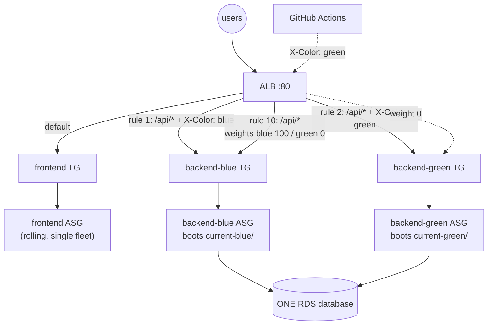
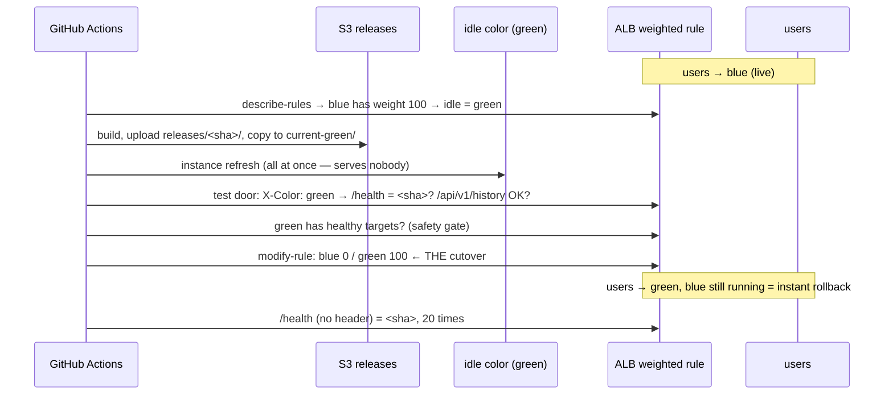

# 16 — Blue/Green Deployment with GitHub Actions

> Two complete backend fleets — **blue** and **green** — behind one load
> balancer. Users only ever reach one of them. A new release goes onto the
> other one, gets tested there through the real load balancer while users
> notice nothing, and then **all** traffic moves in a single API call.
> Rolling back is the same call in reverse — seconds, no rebuild, no
> redeploy. Driven entirely by GitHub Actions; infrastructure by Terraform.

## 1. Theory — deployment strategies, and where blue/green fits

Every deployment answers three questions: *Is the app ever down? Do users
ever hit two versions at once? How fast can I undo it?* Each strategy
trades those against cost:

| Strategy | How | Downtime | Two versions live at once? | Rollback | Extra cost | In this repo |
|---|---|---|---|---|---|---|
| **Recreate** | Stop everything, start the new version | **Yes** | No | Redeploy old version (minutes) | None | lessons 05-11 (`terraform apply` replaced instances) |
| **Rolling, in place** | Update instances one at a time | No | **Yes**, for minutes | Redeploy old version (minutes) | None | [14](../14-cicd-codepipeline/) (CodeDeploy) |
| **Rolling, immutable** | Replace instances one at a time with new ones | No | **Yes**, for minutes | Re-point + replace again (minutes) | Briefly +50% | [15](../15-github-actions-asg/) (instance refresh) |
| **Blue/green** | Build a full second environment, then switch all traffic | No | **No** — one switch moment | **Switch back (seconds)** | **2× the tier**, at least during the deploy | **this lesson** |
| **Canary** | Send a small % of traffic to the new version, increase gradually | No | Yes, *on purpose*, small % | Set the % back to 0 (seconds) | Small | §8 — same mechanism as this lesson |

The two columns blue/green wins are **no mixed versions** and **instant
rollback**. Rolling deploys can't offer either: during a rolling deploy
some users are on v1 and some on v2 ([lesson 14 §5.3](../14-cicd-codepipeline/README.md)
measured it — `m1` and `m2` interleaved for three minutes), and undoing
one means deploying again.

### When it's worth the cost

- The release changes an **API contract** the frontend or other services
  depend on, and you can't have both versions answering at once.
- **Rollback speed matters** more than money — the previous version should
  be one click away, already warm.
- You want to **test the exact production build, on production
  infrastructure, before any user touches it** (§4, the test door).

When it isn't: a static frontend whose old and new files work with the
same backend. That's why this lesson does blue/green for the **backend
only** and keeps the frontend on a cheap rolling replacement (§5).

### Vocabulary

- **Live** color — receives 100% of user traffic.
- **Idle** color — receives none; it's where the next release goes.
- **Cutover** — the moment traffic moves from live to idle.
- **Bake time** — how long you keep the old color running after cutover,
  as the instant-rollback option.

## 2. Where to do the switch

The switch has to sit somewhere *in front of* both fleets:

| Switch point | How | Problem |
|---|---|---|
| **DNS** (e.g. Route 53 weighted records) | Point the hostname at the other environment | Clients and resolvers **cache DNS** for the record's TTL — "switched" users keep reaching the old one for minutes; rollback is just as slow |
| **CodeDeploy blue/green** (`COPY_AUTO_SCALING_GROUP`) | CodeDeploy *copies* your ASG into a new one, deploys there, moves the target group, deletes the old ASG | The ASG Terraform created gets **deleted and replaced by one Terraform has never heard of** — the next `terraform plan` wants to recreate it. Workable, but you must stop managing that ASG with Terraform |
| **Load balancer weights** ← this lesson | One listener rule forwards to two target groups by weight; change the weights | None of the above: takes effect for new requests within seconds, no DNS, and Terraform keeps owning every resource |

## 3. Architecture



What's new compared to lesson 15, all in [`main.tf`](main.tf) and
[`modules/alb-blue-green`](modules/alb-blue-green/main.tf):

- **Two backend ASGs**, created with `for_each = toset(["blue", "green"])`
  on the same `asg` module. Identical except their color: each boots
  from its **own** release pointer (`current-blue/` or `current-green/`)
  and registers into its **own** target group.
- **One weighted listener rule** (priority 10) — `/api/*` and `/health`
  forward to *both* target groups, by weight:

  ```hcl
  action {
    type = "forward"
    forward {
      target_group { arn = aws_lb_target_group.backend["blue"].arn,  weight = 100 }
      target_group { arn = aws_lb_target_group.backend["green"].arn, weight = 0 }
    }
  }
  lifecycle {
    ignore_changes = [action]   # the workflow owns the weights from here on
  }
  ```

- **Two header rules** (priorities 1 and 2) — the **test door**: a request
  carrying `X-Color: green` goes to the green fleet regardless of weights.
  Users never send that header; the pipeline (and you, with `curl`) do.
- **One database, shared.** Blue/green duplicates the *stateless* tier.
  Data can't be duplicated and switched — see §6 for what that implies.
- **One frontend fleet** — rolled, not blue/greened (§5).

### Who owns what: Terraform vs. the pipeline

Terraform creates the rule with blue at 100. From then on the **workflow**
moves the weights — that's the deployment. `ignore_changes = [action]` is
what makes that safe: without it, the next `terraform apply` would
"correct" the weights back to blue = 100 and silently undo a deployment
(§9.5 checks this for real).

## 4. The workflow — `.github/workflows/blue-green-deploy.yml`

[`.github/workflows/blue-green-deploy.yml`](../.github/workflows/blue-green-deploy.yml)
has three modes (Actions → "Blue/green deploy (GitHub Actions)" → Run workflow):

### `deploy` — the blue/green sequence



1. **Find the live color** by reading the rule's weights — the workflow
   keeps no state of its own; the load balancer *is* the source of truth.
2. **Build and publish** the release (same `build-bundles.sh` as lessons
   14 and 15), then copy it to the **idle** color's pointer.
3. **Replace the idle fleet all at once** (`MinHealthyPercentage: 0`). In
   lessons 13-15 that setting would have taken the site down; here the
   idle color serves no users, so the fastest replacement is also safe.
4. **Test through the test door**: `/health` must report the new SHA and
   `/api/v1/history` must succeed — a real request through the new code to
   the shared database — all while 100% of users stay on the live color.
5. **Safety gate**: refuse to switch if the idle target group has no
   healthy targets.
6. **Cutover**: one `aws elbv2 modify-rule` call sets idle = 100, live = 0.
7. **Verify** from the user's side (no header): wait until 20 requests in a
   row return the new SHA — the ALB takes ~11 s to apply new weights (§9.3).
8. **Roll the frontend** (rolling, launch-before-terminate — §5).

### `switch-back` — rollback

Reads the weights, flips them to the other color. Nothing is built,
nothing is replaced: the previous release has been running on that color
the whole time.

### `bootstrap` — first run only

On a brand-new stack neither color has a release yet. Bootstrap installs
the same release on **both** colors and the frontend, with blue live.

### Permissions

[`github.tf`](github.tf) is lesson 15's OIDC setup plus exactly one new
permission — `elasticloadbalancing:ModifyRule`, **on the weighted rule's
ARN only**. The workflow can move traffic between blue and green and do
nothing else to the load balancer.

## 5. Why the frontend isn't blue/green here

The frontend is static files. Old and new builds both call the same
`/api/*` paths, so a user who loads the old page and then hits the new
backend (or vice versa) is fine — **as long as the API change is
backward-compatible**, which §6 requires anyway. A second frontend fleet
would cost money and buy nothing. The workflow rolls it *after* the
backend cutover, so new pages always meet a backend that already serves
the new API.

When would you blue/green the frontend too? When old and new frontends
genuinely can't coexist with the same backend — then you'd put a
`blue`/`green` pair behind the default rule the same way.

## 6. The hard part: one database

Both colors read and write **the same** database. During a deploy the
idle color runs new code against it while the live color still runs old
code against it, and after a switch-back old code runs against whatever
the new code wrote. So every schema change must be **compatible with both
releases at once**. The standard technique is **expand → migrate →
contract**:

| Release | Database change | Old code | New code |
|---|---|---|---|
| N+1 (*expand*) | `ADD COLUMN city_name TEXT` (nullable) | ignores it ✓ | writes both `city` and `city_name` ✓ |
| N+2 (*migrate*) | backfill `city_name` from `city` | — | reads `city_name` ✓ |
| N+3 (*contract*) | `DROP COLUMN city` — only once no release that reads it can come back | — | ✓ |

Never ship "rename a column" as one release in a blue/green setup: the
moment the new color runs its migration, the live (old) color breaks — and
switch-back can't save you, because the data already changed.

This repo's migration is `CREATE TABLE IF NOT EXISTS` — additive and
idempotent, so either color can run it any number of times.

## 7. Cost

| | Lesson 15 | This lesson |
|---|---|---|
| Backend instances | 2 × `t3.small` | 2 × `t3.micro` **per color** = 4 |
| Load balancer, NAT, RDS | same | same |

Both colors run all the time here, so `switch-back` is instant. The
common cheaper variant scales the idle color to 0 after a **bake time**
(say, an hour after cutover) and back up at the start of the next deploy —
you trade instant rollback outside the bake window for half the backend
cost. It's one extra step in the workflow:
`aws autoscaling update-auto-scaling-group --auto-scaling-group-name <old> --min-size 0 --desired-capacity 0`.

## 8. Canary — the same mechanism, smaller steps

Weights don't have to be 100/0. Setting `blue 90 / green 10` sends 10% of
users to the new release while you watch its error rate; then 50/50,
then 0/100. That's a **canary release**, and it's the same `modify-rule`
call with different numbers. Exercise in §10.

## 9. Run it

Lesson 12's AMI must exist; the state bootstrap from lesson 04 too.

```bash
cd 16-blue-green-deployment
cp backend.hcl.example backend.hcl
cp terraform.tfvars.example terraform.tfvars
# terraform.tfvars: github_repo, github_immutable_sub_prefix — same as lesson 15 §5
terraform init -backend-config=backend.hcl
terraform apply                                   # 53 resources, ~8 minutes

# store the workflow's inputs as repository variables (all prefixed BG_)
terraform output -json github_variables | python3 -c "
import json, sys, subprocess
for k, v in json.load(sys.stdin).items():
    subprocess.run(['gh', 'variable', 'set', k, '--body', v, '--repo', '<you>/three-tier-terraform'], check=True)"

gh workflow run blue-green-deploy.yml -f action=bootstrap   # once, on a new stack
```

Everything below is from live runs on the course account. The probe sent
`/health` requests back to back (~4 per second) and logged each response
with a millisecond timestamp — fine enough to see the exact moment of a
cutover. Probe times are local (UTC+6); GitHub step times are UTC.

### 9.1 Bootstrap

```console
Build and publish release ............. 13:24:59 → 13:25:10
Bootstrap — same release on both colors 13:25:10 → 13:28:37
conclusion: success

$ curl $APP_URL/health                       → {"status":"ok","version":"3df945d"}
$ curl -H "X-Color: blue"  $APP_URL/health   → {"status":"ok","version":"3df945d"}
$ curl -H "X-Color: green" $APP_URL/health   → {"status":"ok","version":"3df945d"}
```

The test door works: each color answers on its own, whatever the weights.

### 9.2 Deploy — the cutover, measured

`gh workflow run blue-green-deploy.yml -f action=deploy` with blue live:

```console
action=deploy release=d4db366 live=blue idle=green
Install release on the IDLE color ........ 13:29:31 → 13:31:44   (all of green replaced at once)
green serves d4db366 and reaches the database — users still on blue
green has 2 healthy target(s)
switched: blue=0 green=100 at 13:31:50
```

What users saw:

```console
probe: 3126 requests, 3126 × 200

19:29:03.321  3df945d      ← every response from here …
19:32:01.210  3df945d      ← … to here was the old release
19:32:01.500  d4db366      ← every response from here on was the new one
```

**One switch, no interleaving.** The last old response and the first new
one are a single request apart, and the version never flips back. Compare
[lesson 14 §5.3](../14-cicd-codepipeline/README.md): rolling deploy, `m1`
and `m2` mixed for three minutes. That difference is the whole point of
blue/green.

### 9.3 Real bug: the cutover isn't instant — it takes ~11 seconds

That first deploy **failed** at "Verify users get the new release":

```console
users not on d4db366
##[error]Process completed with exit code 1.
```

The switch API call returned at **13:31:50**; users actually moved at
**13:32:01.5** (19:32:01.5 local) — about **11.5 seconds later**. The ALB
applies a rule change to its fleet of nodes asynchronously; `modify-rule`
returning means "accepted", not "in effect". The verify step had slept a
fixed 5 seconds. Fix — poll, don't sleep:

```bash
wait_for_version() {          # 20 consecutive responses with the new version, up to 90 s
  local ok=0
  for i in $(seq 1 180); do
    if curl -fs "$APP_URL/health" | grep -q "\"version\":\"$1\""; then ok=$((ok+1)); else ok=0; fi
    [ "$ok" -ge 20 ] && { echo "users on $1 after $i requests"; return 0; }
    sleep 0.5
  done
  return 1
}
```

Note what the bug did *not* do: users were never affected — the probe saw
3126 successes. The pipeline just declared failure too early. With the fix,
the second deploy's log reads `users on 774bcee after 33 requests`.

### 9.4 Rollback — switch back

```console
$ gh workflow run blue-green-deploy.yml -f action=switch-back
blue has 2 healthy target(s)
blue is running 3df945d
switched: blue=100 green=0 at 13:42:40
users on 3df945d after 34 requests
Switch back (rollback) step: 13:42:37 → 13:43:11   (34 seconds)
```

```console
probe: 676 requests, 676 × 200
19:42:50.767  d4db366   ← last response from the new release
19:42:51.025  3df945d   ← first response from the old one — and every one after
```

**34 seconds, nothing built, no instance touched** — the old release had
been running on blue the whole time. Compare lesson 15's rollback: a full
instance refresh, ~7 minutes.

### 9.5 Terraform doesn't undo a deployment

With **green** live — while `main.tf` still says blue gets 100 on creation:

```console
$ terraform plan
No changes. Your infrastructure matches the configuration.

$ aws elbv2 describe-rules --rule-arns <weighted rule> \
    --query 'Rules[0].Actions[0].ForwardConfig.TargetGroups[].[TargetGroupArn,Weight]'
three-tier-tf-16-be-blue/...    0
three-tier-tf-16-be-green/...   100
```

That's `ignore_changes = [action]` doing its job. Remove it and this plan
would show the rule being changed back to blue = 100 — an `apply` would
silently roll every user back.

### 9.6 Second deploy — and one honest failure

With the verify fix, blue live again, deploying `774bcee`:

```console
action=deploy release=774bcee live=blue idle=green
Install release on the IDLE color ........ 13:45:32 → 13:48:02
green serves 774bcee and reaches the database — users still on blue
switched: blue=0 green=100 at 13:48:09
users on 774bcee after 33 requests
Roll the frontend ........................ 13:48:37 → 13:54:08
Live: green (774bcee). Previous release still running on blue for instant switch-back.
conclusion: success   (9 min total; the backend cutover itself ~3 min after the build)
```

```console
probe: 2647 requests, 2646 × 200, 1 × timeout

19:48:16.169  3df945d  200
19:48:19.304           000   ← sent 19:48:16.2, no answer within 3 s
19:48:19.607  774bcee  200   ← new release from here on
```

One request — the one in flight at the exact moment the ALB applied the
new weights — timed out. The first deploy had none in 3126. A single
in-flight request caught by a rule change is rare but possible; it's why
real clients **retry idempotent requests** (GET `/health`, GET `/history`)
rather than treat one timeout as an outage. Reported here instead of
trimmed — "zero failures" would have been true once and false the next time.

### 9.7 Two more real bugs, already fixed in lessons 15 and 16

**The grace period that froze every refresh.** The first bootstrap sat at
`InProgress 0%` for 18 minutes with every target already `healthy`:

```console
InProgress   0   Waiting for remaining instances to be available. For example:
                 i-00272ff40bf07ea33 has insufficient data to evaluate its health with Elastic Load Balancing.
```

The ASGs had `health_check_grace_period = 1500` (25 minutes — chosen so
new instances could wait for a first release). During the grace period
an ASG **ignores** load-balancer health, so an instance refresh can't
start until every instance is past it. Fix: 300 s, and instances wait at
most 4 minutes for a release before failing and being replaced. After the
fix: same refresh, ~5.5 minutes. (Lesson 15 had the same setting; it's
fixed there too.)

**An idle color with no release.** On a brand-new stack neither color has
a release, so `deploy` would test and switch to an empty fleet — the
safety gate (`require_healthy`) refuses that, and `bootstrap` exists to
seed both colors once.

## 10. Exercises

1. **Watch a cutover yourself.** Run this, then `deploy` from GitHub:

   ```bash
   while true; do echo "$(date +%T) $(curl -s $APP_URL/health)"; done
   ```

   You'll see one line where the version changes — and never change back.
2. **Test before users do.** After the idle color is installed but before
   the switch, `curl -H "X-Color: <idle>" $APP_URL/api/v1/history` — that's
   the new code, on production infrastructure, against the real database.
3. **Rollback drill.** `deploy`, then `switch-back`, timing both. Explain
   why one takes minutes and the other seconds.
4. **Canary by hand.** Send 10% of users to the idle color:

   ```bash
   aws elbv2 modify-rule --rule-arn "$BG_RULE_ARN" --actions '[{"Type":"forward","ForwardConfig":{"TargetGroups":[
     {"TargetGroupArn":"'"$BG_BLUE_TG_ARN"'","Weight":90},{"TargetGroupArn":"'"$BG_GREEN_TG_ARN"'","Weight":10}]}}]'
   ```

   Run exercise 1's loop: roughly 1 in 10 lines shows the other version.
   That *is* mixed versions — deliberately, for a small slice of users.
   Then add a `canary` action to the workflow (90/10 → wait → 50/50 → wait → 0/100).
5. **Break the gate.** Set the idle ASG's desired capacity to 0, then run
   `deploy`. The workflow must refuse to switch — which step stops it, and why?

## 11. Clean up

```bash
terraform destroy
```

…or at the end of class, everything (including the `BG_*` repo variables):

```bash
bash scripts/cleanup-everything.sh --yes --github-repo <you>/three-tier-terraform
```

## If it breaks

- **Refresh stuck at 0%, "insufficient data to evaluate its health"** —
  instances still in their health-check grace period; see §9.7. Check
  `health_check_grace_period` is 300, not more.
- **Deploy fails at "Test the idle color"** — the idle color isn't running
  the new release. Check `aws s3 ls s3://<bucket>/current-<color>/` and one
  instance's `/var/log/user-data.log` over SSM.
- **`refusing to switch: green has no healthy targets`** — the safety gate
  working. Fix the idle fleet first; users are still on the live color.
- **"users not on <sha> after 90 s"** — the switch happened but users don't
  see the new version: check the weights with `aws elbv2 describe-rules`,
  and whether a header rule's priority is shadowing the weighted rule.
- **`Not authorized to perform sts:AssumeRoleWithWebIdentity`** — same as
  lesson 15 §3: branch not allowed, or `github_immutable_sub_prefix` empty.
- **After `terraform apply`, users are back on blue** — someone removed
  `ignore_changes = [action]` from the weighted rule (§9.5).
